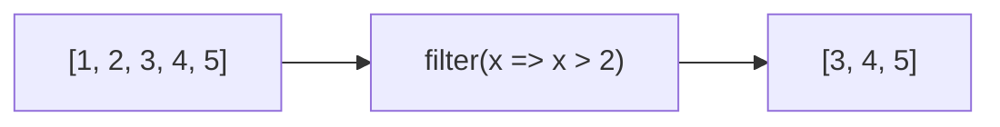

# filter()

## Introduction

`filter()` creates a new array with elements that pass a **test function**. It's used for selection/filtering data.

## Visual Explanation



## Examples

```javascript
const numbers = [1, 2, 3, 4, 5];
const evens = numbers.filter(n => n % 2 === 0);
// [2, 4]

const users = [
  { name: 'Alice', age: 17 },
  { name: 'Bob', age: 22 }
];
const adults = users.filter(user => user.age >= 18);
// [{ name: 'Bob', age: 22 }]
```

## Summary

- Returns filtered array with elements that pass the test
- Does NOT mutate original
- Can return fewer elements than original
- Great for search/filter interfaces

## Further Reading

- [MDN: Array.prototype.filter()](https://developer.mozilla.org/en-US/docs/Web/JavaScript/Reference/Global_Objects/Array/filter)
