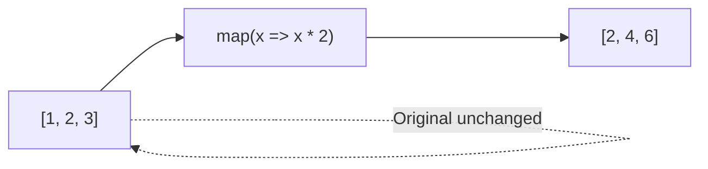

# map()

## Introduction

`map()` creates a **new array** by applying a function to every element of the original array. It does not mutate the original.

## Visual Explanation



## Syntax

```javascript
const newArray = array.map((element, index, array) => {
  return transformedElement;
});
```

## Examples

```javascript
const numbers = [1, 2, 3, 4];
const doubled = numbers.map(n => n * 2);
// [2, 4, 6, 8]

const users = [{name: 'Alice'}, {name: 'Bob'}];
const names = users.map(user => user.name);
// ['Alice', 'Bob']
```

## Summary

- Creates new array with transformed elements
- Does NOT mutate original
- Returns same length as original
- Chainable with filter, reduce, etc.

## Further Reading

- [MDN: Array.prototype.map()](https://developer.mozilla.org/en-US/docs/Web/JavaScript/Reference/Global_Objects/Array/map)
