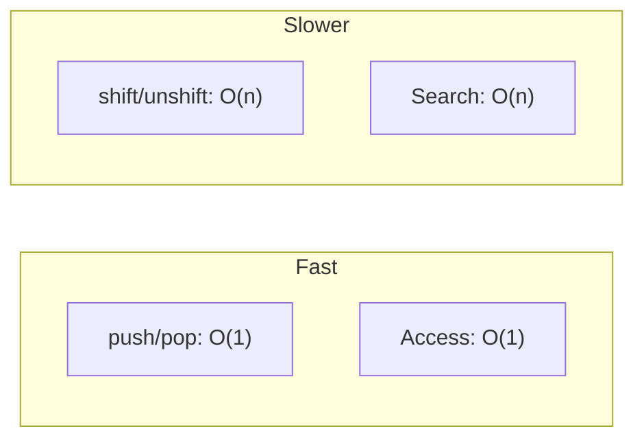

# Array Performance

## Introduction

Different array operations have different **time complexities**. Understanding these helps you write efficient code.

## Performance Table

| Operation | Time Complexity | Method |
|-----------|----------------|--------|
| Access by index | O(1) | `arr[i]` |
| Add to end | O(1) | `push()` |
| Remove from end | O(1) | `pop()` |
| Add to start | O(n) | `unshift()` |
| Remove from start | O(n) | `shift()` |
| Insert/Remove | O(n) | `splice()` |
| Search (unsorted) | O(n) | `find()`, `indexOf()` |
| Sort | O(n log n) | `sort()` |
| Iteration | O(n) | `forEach()`, `map()` |

## Visual Explanation

## Best Practices

- Prefer `push/pop` over `shift/unshift` for queue-like operations
- Use typed arrays for large numeric datasets
- Avoid frequent `splice` on large arrays

## Summary

- End operations (push/pop) are O(1) — fast
- Start operations (shift/unshift) are O(n) — slower
- Index access is O(1) — instant

## Further Reading

- [V8: Array Performance](https://v8.dev/blog/elements-kinds)
