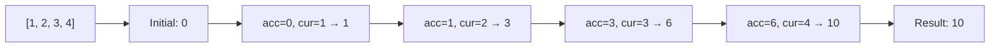

# reduce()

## Introduction

`reduce()` executes a **reducer function** on each element, resulting in a **single accumulated value**. It's the most versatile array transformation method.

## Visual Explanation



## Syntax

```javascript
array.reduce((accumulator, currentValue, index, array) => {
  return newAccumulator;
}, initialValue);
```

## Examples

```javascript
// Sum
[1, 2, 3, 4].reduce((acc, cur) => acc + cur, 0); // 10

// Max value
[3, 7, 2, 9].reduce((acc, cur) => Math.max(acc, cur)); // 9

// Group by
const items = [
  { type: 'fruit', name: 'apple' },
  { type: 'fruit', name: 'banana' },
  { type: 'veg', name: 'carrot' }
];

items.reduce((acc, item) => {
  (acc[item.type] = acc[item.type] || []).push(item.name);
  return acc;
}, {});
// { fruit: ['apple', 'banana'], veg: ['carrot'] }
```

## Summary

- Reduces array to a single value
- Most powerful array method — can implement map, filter, etc.
- Always provide an initial value to avoid edge cases

## Further Reading

- [MDN: Array.prototype.reduce()](https://developer.mozilla.org/en-US/docs/Web/JavaScript/Reference/Global_Objects/Array/reduce)
