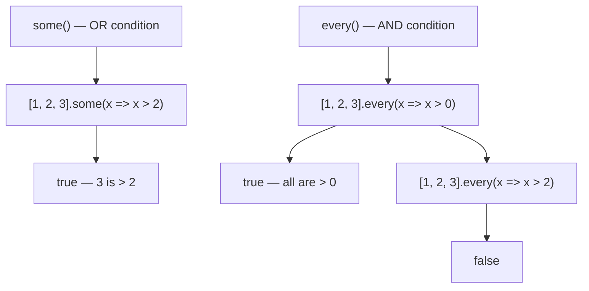

# some() & every()

## Introduction

`some()` checks if **at least one** element passes a test. `every()` checks if **all** elements pass a test. Both return a boolean.

## Visual Explanation



## Examples

```javascript
const numbers = [1, 2, 3, 4, 5];

numbers.some(x => x > 4);  // true — 5 qualifies
numbers.every(x => x > 0); // true
numbers.every(x => x > 3); // false
```

## Use Cases

```javascript
// Validation
const formFields = [
  { value: 'Alice', required: true },
  { value: '', required: true },
  { value: 'alice@email.com', required: true }
];

const allFilled = formFields.every(f => f.value !== '');
const anyEmpty = formFields.some(f => f.value === '');
```

## Summary

- `some()` — at least one passes (short-circuits on true)
- `every()` — all pass (short-circuits on false)
- Both return boolean values

## Further Reading

- [MDN: Array.prototype.some()](https://developer.mozilla.org/en-US/docs/Web/JavaScript/Reference/Global_Objects/Array/some)
- [MDN: Array.prototype.every()](https://developer.mozilla.org/en-US/docs/Web/JavaScript/Reference/Global_Objects/Array/every)
