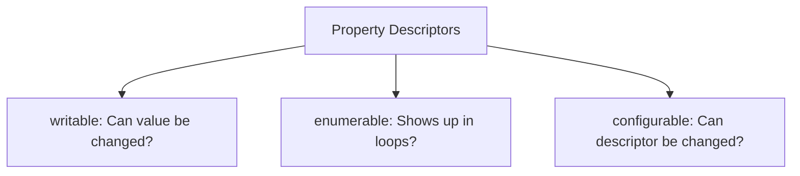

# Property Descriptors

## Introduction

Every property in JavaScript has a **property descriptor** — an object that describes its behavior. The three main attributes are `writable`, `enumerable`, and `configurable`.

## Visual Explanation



## Getting Descriptors

```javascript
const user = { name: 'Alice' };

const descriptor = Object.getOwnPropertyDescriptor(user, 'name');
// { value: 'Alice', writable: true, enumerable: true, configurable: true }
```

## Descriptor Attributes

- **writable** — `true` if the value can be changed
- **enumerable** — `true` if it appears in `for...in` and `Object.keys()`
- **configurable** — `true` if the descriptor can be changed or property deleted

## Summary

- Every property has a descriptor with 3 boolean flags
- `writable` — can the value change?
- `enumerable` — does it appear in iteration?
- `configurable` — can the descriptor be modified?

## Further Reading

- [MDN: Property Descriptors](https://developer.mozilla.org/en-US/docs/Web/JavaScript/Reference/Global_Objects/Object/getOwnPropertyDescriptor)
