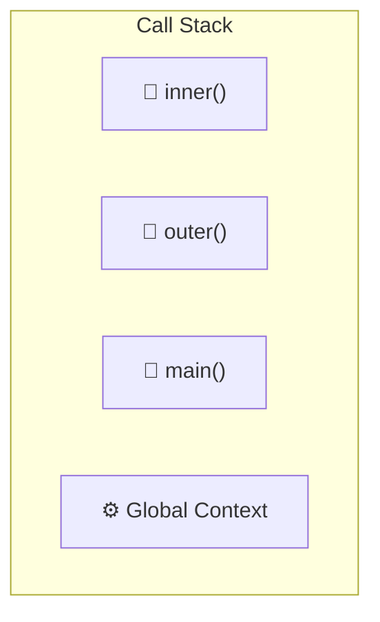

# Call Stack

## Introduction

The **call stack** is a data structure that tracks the execution of function calls. It operates as **Last In, First Out (LIFO)** — the most recently called function is the first to complete.

## Learning Objectives

- Understand how the call stack tracks function execution
- Identify stack frames and their components
- Recognize and avoid stack overflow
- Trace execution through the call stack

## Visual Summary



## Topics Covered

| Topic | Description | Est. Time |
|-------|-------------|-----------|
| [Stack Frames](./stack-frames) | How function calls are tracked | 15 min |
| [Stack Overflow](./stack-overflow) | Maximum call stack size and recursion limits | 10 min |
| [Async Stack](./async-stack) | How async operations interact with the stack | 10 min |

## Prerequisites

- Execution context
- Functions and function calls
- Recursion basics

## Learning Path

```
Stack Frames → Stack Overflow → Async Stack
```

## Related Topics

- [Execution Context](../execution-context/)
- [Hoisting](../hoisting/)
- [Event Loop](../phase-03-asynchronous-javascript/event-loop)
