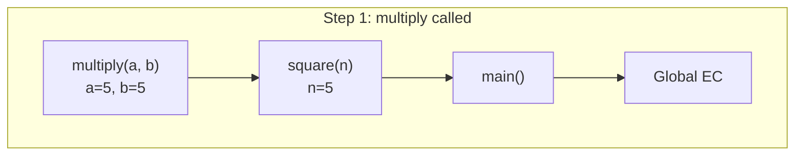

# Stack Frames

## Introduction

Each function call creates a **stack frame** on the call stack. A stack frame contains the function's execution context, local variables, and return address.

## How Stack Frames Work

```javascript
function multiply(a, b) {
  return a * b;
}

function square(n) {
  return multiply(n, n);
}

function main() {
  const result = square(5);
  console.log(result);
}

main();
```

### Stack Trace Step by Step:

```
1. [Global]           — script starts
2. [Global, main()]   — main() called
3. [Global, main(), square()]    — square(5) called
4. [Global, main(), square(), multiply()] — multiply(5,5) called
5. [Global, main(), square()]    — multiply returns 25
6. [Global, main()]              — square returns 25
7. [Global]                      — main() returns
```

## Visual Stack



## What's in a Stack Frame

Each frame contains:
- The function's execution context
- Local variables and parameters
- The return address (where to continue after function returns)

## Error Stack Traces

```javascript
function a() { b(); }
function b() { c(); }
function c() { throw new Error('Something went wrong'); }

a();
// Error: Something went wrong
//   at c (file.js:2:18)
//   at b (file.js:1:29)
//   at a (file.js:1:20)
//   at main (file.js:5:1)
// The stack trace shows the frame order!
```

## Summary

- Each function call pushes a stack frame
- Frames are LIFO (Last In, First Out)
- Frame contains: local vars, params, return address
- Stack traces show the frame order
- Frames are popped when function returns

## Further Reading

- [MDN: Call Stack](https://developer.mozilla.org/en-US/docs/Glossary/Call_stack)
- [Next: Stack Overflow](./stack-overflow)
