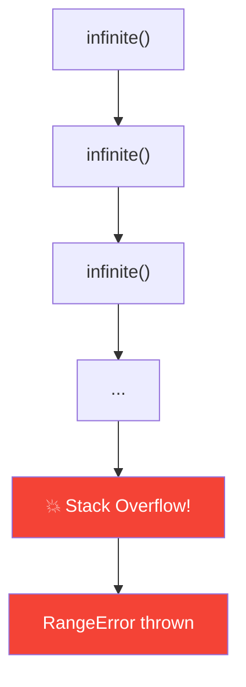

# Stack Overflow

## Introduction

**Stack overflow** occurs when the call stack exceeds its maximum size. This happens with infinite recursion or extremely deep function calls.

## Infinite Recursion

```javascript
function infinite() {
  return infinite(); // calls itself forever
}

// RangeError: Maximum call stack size exceeded
infinite();
```

## Visual



## Maximum Stack Size

```javascript
let depth = 0;
function measure() {
  depth++;
  measure();
}

try {
  measure();
} catch (e) {
  console.log(`Max stack depth: ${depth}`);
}
// V8 typically ~10,000 frames; depends on environment
```

## Real Causes

```javascript
// 1. Accidental infinite recursion
function factorial(n) {
  // ❌ Missing base case
  return n * factorial(n - 1);
}

// ✅ With base case
function factorial(n) {
  if (n <= 1) return 1; // base case
  return n * factorial(n - 1);
}

// 2. Deep object traversal without cycle detection
function deepClone(obj) {
  // ❌ Circular reference will overflow
  return { ...obj, nested: deepClone(obj) };
}

// 3. Event loop starvation
function loop() {
  processNext();
  loop(); // never yields to event loop
}
```

## Prevention

```javascript
// 1. Always use base cases in recursion
// 2. Track depth for safety
function safeRecursive(n, maxDepth = 1000) {
  if (maxDepth <= 0) throw new Error('Max depth exceeded');
  if (n <= 1) return 1;
  return n * safeRecursive(n - 1, maxDepth - 1);
}

// 3. Convert deep recursion to iteration
function factorialIterative(n) {
  let result = 1;
  for (let i = 2; i <= n; i++) result *= i;
  return result;
}
```

## Summary

- Stack overflow = call stack exceeds maximum size
- Most common cause: infinite recursion
- Typical limit: ~10,000 frames (V8)
- Always use base cases in recursion
- Consider iterative alternatives for deep operations

## Further Reading

- [MDN: RangeError](https://developer.mozilla.org/en-US/docs/Web/JavaScript/Reference/Global_Objects/RangeError)
- [Previous: Stack Frames](./stack-frames)
- [Next: Async Stack](./async-stack)
