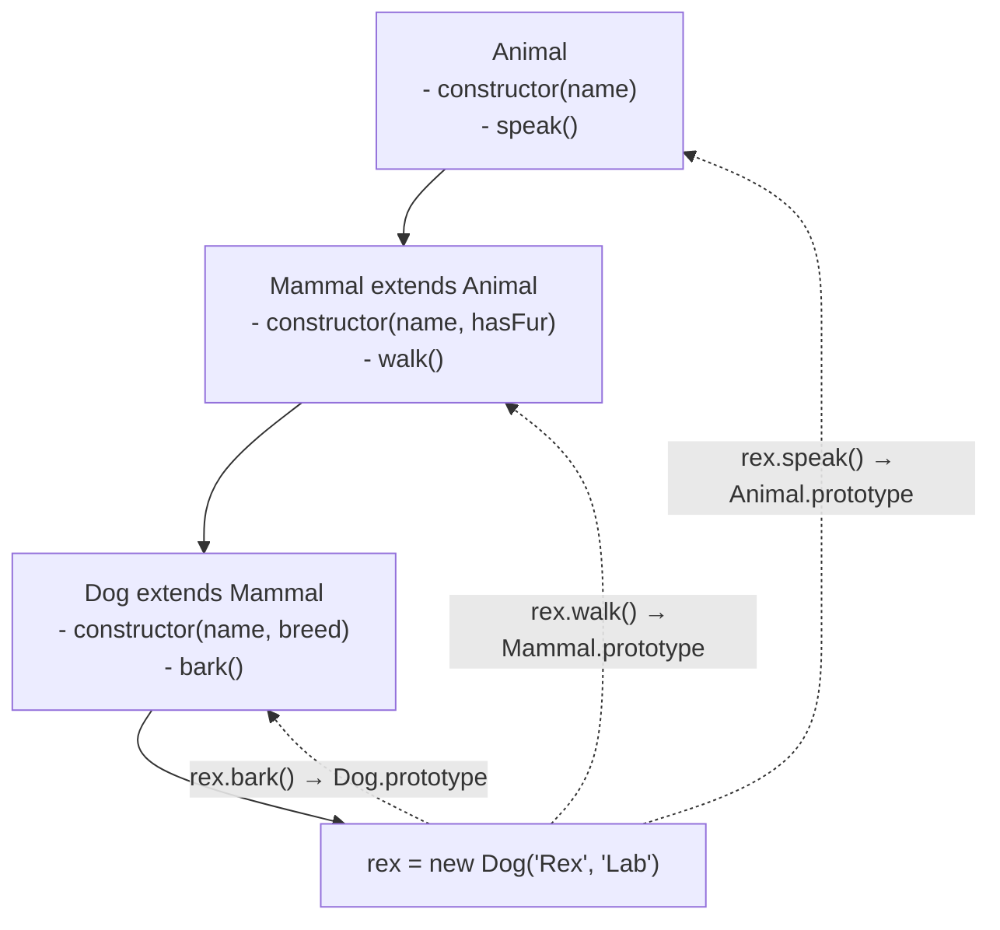

# extends & super

## Introduction

The `extends` keyword creates a class that inherits from another class (the parent). `super` is used to call the parent's constructor and methods.

## Basic Inheritance

```javascript
class Animal {
  constructor(name) {
    this.name = name;
  }
  
  speak() {
    return `${this.name} makes a sound`;
  }
}

class Dog extends Animal {
  constructor(name, breed) {
    super(name); // call parent constructor
    this.breed = breed;
  }
  
  bark() {
    return `${this.name} barks loudly!`;
  }
}

const rex = new Dog('Rex', 'Labrador');
console.log(rex.speak()); // "Rex makes a sound" — inherited
console.log(rex.bark());  // "Rex barks loudly!" — own method
```

## Method Overriding

```javascript
class Animal {
  speak() {
    return `${this.name} makes a sound`;
  }
}

class Dog extends Animal {
  speak() {
    return `${this.name} barks!`; // overrides parent
  }
}

const rex = new Dog('Rex');
console.log(rex.speak()); // "Rex barks!" — Dog's version
```

## Using super.method()

```javascript
class Animal {
  speak() {
    return `${this.name} makes a sound`;
  }
}

class Dog extends Animal {
  speak() {
    // Call parent method, then extend it
    const parentMessage = super.speak();
    return `${parentMessage} — specifically, it barks!`;
  }
}

const rex = new Dog('Rex');
console.log(rex.speak()); 
// "Rex makes a sound — specifically, it barks!"
```

## Visual Inheritance



## Overriding Constructor

```javascript
class Animal {
  constructor(name) {
    this.name = name;
  }
}

class Dog extends Animal {
  constructor(name, breed) {
    super(name); // ✅ Required before this
    this.breed = breed;
  }
}

// Without super:
class BadDog extends Animal {
  constructor(name, breed) {
    // ❌ ReferenceError: Must call super first
    this.breed = breed; 
    super(name);
  }
}
```

## extends Expressions

`extends` works with any expression that returns a constructor:

```javascript
function createBase(prefix) {
  return class {
    greet() { return `${prefix}: Hello!`; }
  };
}

class Specific extends createBase('API') {
  // ...
}

const obj = new Specific();
console.log(obj.greet()); // "API: Hello!"
```

## Summary

- `extends` creates a parent-child class relationship
- `super()` calls the parent constructor (required before `this`)
- `super.method()` calls a parent method
- Method overriding replaces parent behavior
- `extends` can be used with expressions

## Further Reading

- [MDN: extends](https://developer.mozilla.org/en-US/docs/Web/JavaScript/Reference/Classes/extends)
- [MDN: super](https://developer.mozilla.org/en-US/docs/Web/JavaScript/Reference/Operators/super)
- [Previous: Constructor](./constructor)
- [Next: Getters & Setters](./getters-setters)
