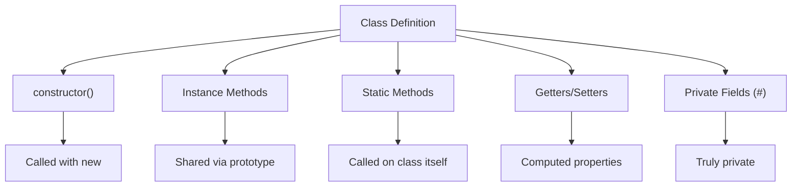

# Classes

## Introduction

ES6 classes are **syntactic sugar** over JavaScript's existing prototypal inheritance. They provide a cleaner, more familiar syntax for creating constructor functions and managing prototypes.

## Learning Objectives

- Write class declarations and expressions
- Understand constructors and instance initialization
- Use `extends` and `super` for inheritance
- Implement getters, setters, and computed properties
- Use static methods and fields
- Understand private fields with `#`

## Visual Summary



## Topics Covered

| Topic | Description | Est. Time |
|-------|-------------|-----------|
| [Class Declaration](./class-declaration) | class syntax, class expressions | 10 min |
| [Constructor](./constructor) | Initialization, super() | 10 min |
| [extends & super](./extends-super) | Inheritance, method overriding | 15 min |
| [Getters & Setters](./getters-setters) | Computed properties | 10 min |
| [Static Members](./static-members) | Static methods and fields | 10 min |
| [Private Fields](./private-fields) | `#` prefix for true privacy | 15 min |

## Prerequisites

- Functions and constructors
- Prototypes and prototype chain
- Objects and property descriptors

## Learning Path

```
Class Declaration → Constructor → extends & super → Getters & Setters → Static Members → Private Fields
```

## Related Topics

- [Prototypes](../prototypes/)
- [Inheritance](../inheritance/)
- [Execution Context](../execution-context/)
