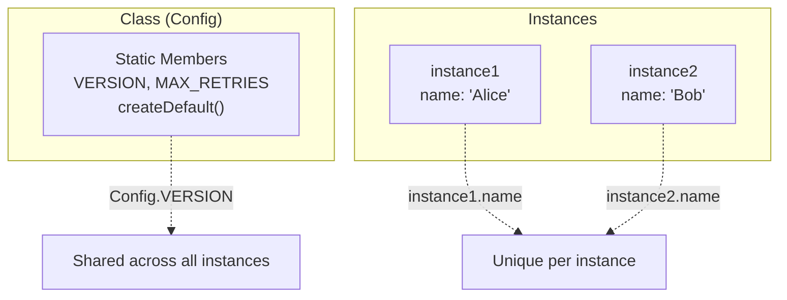

# Static Members

## Introduction

**Static methods** and **static fields** belong to the **class itself**, not to instances. They are called on the class: `ClassName.method()` instead of `instance.method()`.

## Static Methods

```javascript
class MathUtils {
  static add(a, b) {
    return a + b;
  }
  
  static multiply(a, b) {
    return a * b;
  }
}

// Called on the class, not an instance
console.log(MathUtils.add(2, 3));      // 5
console.log(MathUtils.multiply(4, 5)); // 20

// ❌ Cannot call on instances
const utils = new MathUtils();
console.log(utils.add(2, 3)); // TypeError: utils.add is not a function
```

## Static Fields

```javascript
class Config {
  static VERSION = '1.0.0';
  static MAX_RETRIES = 3;
  static DEFAULT_TIMEOUT = 5000;
}

console.log(Config.VERSION);        // '1.0.0'
console.log(Config.MAX_RETRIES);    // 3
console.log(Config.DEFAULT_TIMEOUT); // 5000
```

## Static vs Instance



## this in Static Methods

Inside a static method, `this` refers to the class:

```javascript
class Calculator {
  static PI = 3.14159;
  
  static circleArea(radius) {
    return this.PI * radius * radius; // this = Calculator
  }
  
  static create() {
    return new this(); // creates new Calculator instance
  }
}

console.log(Calculator.circleArea(5)); // 78.53975
const calc = Calculator.create(); // new Calculator()
```

## Static Inheritance

Static members are inherited:

```javascript
class Parent {
  static greet() {
    return 'Hello from Parent';
  }
  static ID = 'parent';
}

class Child extends Parent {}

console.log(Child.greet()); // 'Hello from Parent'
console.log(Child.ID);      // 'parent'
```

## Practical Use Cases

```javascript
// 1. Factory methods
class User {
  constructor(name) { this.name = name; }
  
  static createAnonymous() {
    return new User('Anonymous');
  }
  
  static createAdmin() {
    return new User('Admin');
  }
}

const anon = User.createAnonymous();
const admin = User.createAdmin();

// 2. Utility/helper methods
class Validator {
  static isEmail(str) {
    return /^[^\s@]+@[^\s@]+\.[^\s@]+$/.test(str);
  }
  
  static isUrl(str) {
    try { new URL(str); return true; }
    catch { return false; }
  }
}

console.log(Validator.isEmail('test@email.com')); // true
console.log(Validator.isUrl('https://example.com')); // true
```

## Best Practices

- Use statics for utility functions related to the class
- Use statics for factory methods (alternative constructors)
- Use static fields for configuration constants
- Avoid storing mutable data in static fields (shared across all instances)

## Summary

- Static members belong to the class, not instances
- Access them as `ClassName.method()` or `ClassName.field`
- `this` in static methods refers to the class
- Static members are inherited by subclasses
- Useful for utilities, factories, and configuration

## Further Reading

- [MDN: static](https://developer.mozilla.org/en-US/docs/Web/JavaScript/Reference/Classes/static)
- [Previous: Getters & Setters](./getters-setters)
- [Next: Private Fields](./private-fields)
