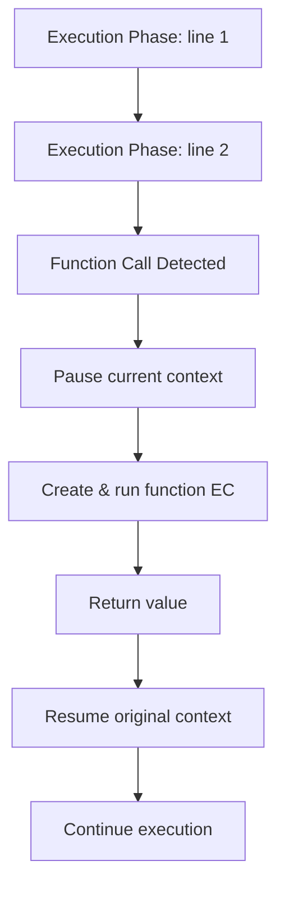

# Execution Phase

## Introduction

The **Execution Phase** is where JavaScript **actually runs the code** line by line. Variables are assigned values, function calls are made, and new execution contexts are created.

## What Happens

1. Execute code **line by line** (top to bottom)
2. Assign values to variables
3. Execute function calls (creating new contexts)
4. Handle operators, conditionals, loops

## Example Walkthrough

```javascript
var a = 10;
let b = 20;
const c = 30;

function greet(name) {
  return `Hello, ${name}!`;
}

const message = greet('Alice');
console.log(message);
```

### Step by Step Execution:

1. `var a = 10;` → assign 10 to `a` (was `undefined`)
2. `let b = 20;` → assign 20 to `b` (was in TDZ)
3. `const c = 30;` → assign 30 to `c`
4. `function greet(name) {...}` → already stored in creation phase
5. `const message = greet('Alice');` → function call!
   - Create new function EC for `greet`
   - Run its creation and execution phases
   - Return value assigned to `message`
6. `console.log(message);` → log the value

## Function Call Flow



## Assignment During Execution

```javascript
// Creation phase: all vars are undefined
var x;  // x = undefined

// Execution phase: assignments happen here
x = 10;  // now x = 10
x = 20;  // now x = 20

// let/const are in TDZ until here
let y;   // y is in TDZ during creation
y = 30;  // TDZ ends, y = 30
```

## Summary

- Code runs **line by line** during execution phase
- Variable assignments happen here (not creation)
- Function calls create new contexts (pausing current one)
- After function returns, original context resumes
- The execution phase follows the creation phase

## Further Reading

- [ECMAScript: Execution](https://tc39.es/ecma262/#sec-execution-contexts)
- [Previous: Creation Phase](./creation-phase)
- [Next: Lexical Environment](./lexical-environment)
