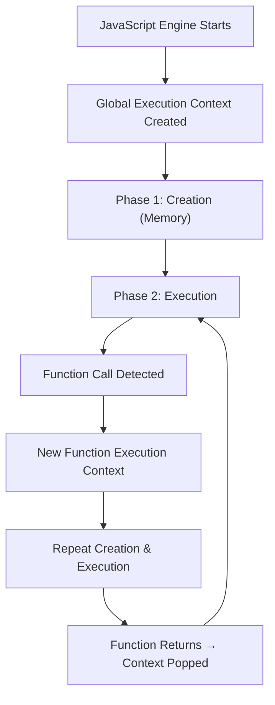

# Execution Context

## Introduction

An **execution context** is the environment where JavaScript code is evaluated and executed. Every time a function is called, a new execution context is created.

## Learning Objectives

- Understand the three types of execution context (global, function, eval)
- Learn the two phases: creation and execution
- Understand the lexical environment and variable environment
- Know how execution contexts are pushed/popped from the call stack

## Visual Summary



## Topics Covered

| Topic | Description | Est. Time |
|-------|-------------|-----------|
| [Types of Context](./types-of-context) | Global, function, and eval contexts | 10 min |
| [Creation Phase](./creation-phase) | Memory allocation, hoisting, scope setup | 15 min |
| [Execution Phase](./execution-phase) | Code execution, variable assignment | 10 min |
| [Lexical Environment](./lexical-environment) | Environment records, scope chain | 15 min |

## Prerequisites

- Basic JavaScript syntax
- Functions and scope
- Hoisting basics

## Learning Path

```
Types of Context → Creation Phase → Execution Phase → Lexical Environment
```

## Related Topics

- [Call Stack](../call-stack/)
- [Hoisting](../hoisting/)
- [Scope](../../phase-01-fundamentals/08-scope/)
