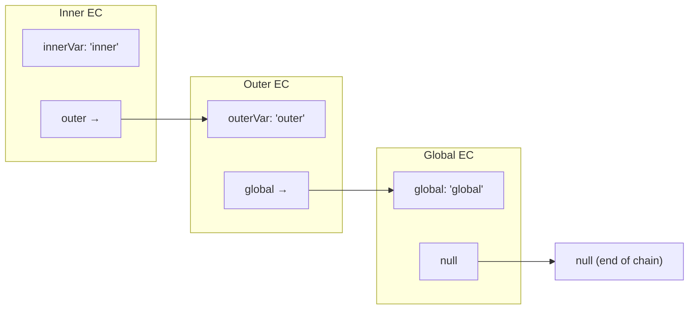

# Lexical Environment

## Introduction

A **lexical environment** is a specification type that defines the association between identifiers (variable names) and their values within a scope.

## Structure

```javascript
ExecutionContext = {
  lexicalEnvironment: {
    environmentRecord: {
      type: 'Object' or 'Declarative',
      // Variables, functions, let/const declarations
    },
    outerEnvironmentReference: // Parent scope
  },
  variableEnvironment: {
    // Similar but for var declarations
  },
  thisBinding: // Value of 'this'
}
```

## Environment Record Types

- **Declarative**: For functions, catch blocks — stores let, const, class, function declarations
- **Object**: For global context — stores var declarations as properties

## Outer Environment Reference

Each lexical environment has a reference to its **outer (parent) environment**, forming the scope chain:

```javascript
const global = 'global';

function outer() {
  const outerVar = 'outer';
  
  function inner() {
    const innerVar = 'inner';
    console.log(innerVar); // own
    console.log(outerVar); // from outer reference
    console.log(global);   // from outer's outer reference
  }
  
  inner();
}

outer();
```

## Visual



## Lexical vs Variable Environment

- **LexicalEnvironment**: Stores `let`, `const`, and function declarations
- **VariableEnvironment**: Stores `var` declarations

They're usually the same, except in `catch` and `with` blocks.

## Summary

- Lexical environment = environment record + outer reference
- Forms the scope chain for variable lookup
- Outer reference connects to parent scope
- LexicalEnvironment (let/const) vs VariableEnvironment (var)
- The chain ends at global environment's outer reference (null)

## Further Reading

- [ECMAScript: Lexical Environments](https://tc39.es/ecma262/#sec-lexical-environments)
- [Previous: Execution Phase](./execution-phase)
