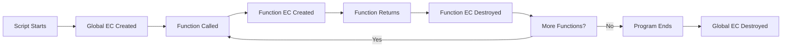

# Types of Execution Context

## Introduction

JavaScript has three types of execution contexts: **global**, **function**, and **eval**. Each is created at different times and serves a different purpose.

## 1. Global Execution Context

Created when the JavaScript script first runs:

```javascript
// This runs in the global execution context
const globalVar = 'I am global';

function outer() {
  // Function execution context
}
```

- Only **one** global context exists
- It's the **default** context
- In browsers: `this` = `window`
- In Node.js: `this` = `global`
- Remains active until the program ends

## 2. Function Execution Context

Created every time a function is **called** (not defined):

```javascript
function first() {
  // Function EC for first()
  function second() {
    // Function EC for second()
  }
  second();
}

first();
// Creates: Global EC → first() EC → second() EC
```

- Each function call creates a **new** context
- Multiple function contexts can exist (stacked)
- Each has its own variable environment and `this` binding

## 3. Eval Context

Created when code is executed inside `eval()`:

```javascript
eval('var x = 10;'); // Creates an eval execution context
```

- Rarely used (and discouraged)
- Has its own scope
- Can access the enclosing scope

## Context Lifecycle



## Summary

| Type | Created When | How Many Can Exist |
|------|-------------|-------------------|
| Global | Script starts | 1 |
| Function | Function is called | Multiple (stacked) |
| Eval | eval() is called | Multiple |

## Further Reading

- [MDN: Execution Context](https://developer.mozilla.org/en-US/docs/Web/JavaScript/Guide/Closures)
- [Next: Creation Phase](./creation-phase)
