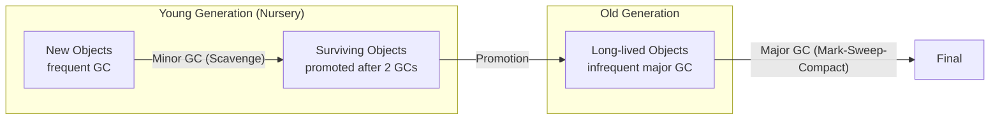

# Generational GC

## Introduction

V8 (and most modern JS engines) uses a **generational** approach to garbage collection. The insight: most objects die young ("the generational hypothesis").

## Young Generation (Nursery)

Newly created objects live here:

```javascript
function process() {
  // These objects are created in the young generation
  const temp = { data: 'temporary' };
  const result = temp.data.toUpperCase();
  return result;
  // Both 'temp' and the upper case string are likely
  // collected in the next minor GC
}
```

- Small region of memory
- Collected **frequently** (minor GC)
- Uses **Scavenge** algorithm (fast copy collector)
- Objects surviving 2 GC cycles → **promoted** to old generation

## Old Generation

Long-lived objects live here:

```javascript
// These objects survive and get promoted
const appConfig = { theme: 'dark', lang: 'en' };
const cache = new Map();

function setup() {
  const handler = () => console.log('ready');
  window.addEventListener('load', handler);
  // handler survives because it's referenced by the event system
}
```

- Larger region of memory
- Collected **infrequently** (major GC)
- Uses **Mark-Sweep-Compact** algorithm
- More expensive to collect

## Visual Overview



## Why Generational?

| Aspect | Young Gen | Old Gen |
|--------|-----------|---------|
| Size | Small (~8MB) | Large (rest of heap) |
| GC frequency | Frequent | Infrequent |
| GC speed | Fast (~ms) | Slower (~ms to 100ms) |
| Algorithm | Scavenge (copy) | Mark-Sweep-Compact |
| Most objects | Die here | Survive here |

## Incremental & Concurrent GC

Modern V8 performs GC work **incrementally** and **concurrently** to avoid long pauses:

- **Incremental**: Break GC work into small chunks between JS tasks
- **Concurrent**: GC work runs in parallel with your code (multi-core)

This means you rarely notice GC pauses in modern browsers.

## Best Practices

- Create objects only when needed (avoid temporary objects in hot loops)
- Reuse objects rather than creating new ones
- Large caches can cause old gen GC pressure
- Modern V8 handles most patterns well

## Further Reading

- [V8: Trash Talk](https://v8.dev/blog/trash-talk)
- [Previous: Mark-and-Sweep](./mark-and-sweep)
- [Next: Common Leaks](./common-leaks)
