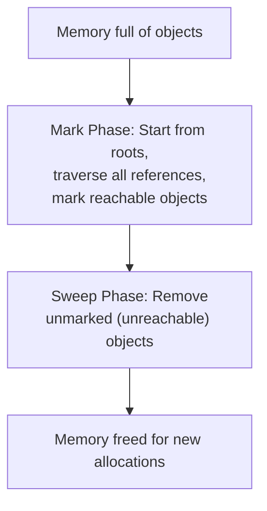

# Mark-and-Sweep

## Introduction

**Mark-and-sweep** is the fundamental algorithm JavaScript engines use for garbage collection. It works in two phases: **mark** (find reachable objects) and **sweep** (remove unreachable ones).

## How It Works



## The Mark Phase

The GC starts from **roots** — objects that are always reachable:

- The global object (window/globalThis)
- Local variables in the current function
- Parameters
- The call stack

From these roots, the GC **traverses all references**, marking every object it can reach.

## The Sweep Phase

Any object **not marked** during the traversal is considered unreachable and its memory is freed.

```javascript
// Reachable objects (marked — kept alive)
const globalData = { value: 'important' };

function process() {
  const local = { nested: { deep: 'data' } };
  // local, nested, deep are all reachable during execution
  return local.nested.deep;
}
// After return, local is unreachable → GC can collect it
```

## What Stops Mark-and-Sweep?

```javascript
let user = { name: 'Alice' };
let admin = user; // Both reference the same object

user = null; // Object is still reachable via 'admin'
// GC cannot collect it yet

admin = null; // Now unreachable → eligible for collection
```

## Visual Example

```javascript
// Objects and their references:
const root = {
  child1: { data: 'A' },
  child2: { data: 'B' }
};
// root → child1 ✅
// root → child2 ✅

root.child1 = null;
// child1 is still reachable? 
// No! root.child1 = null removes the reference
// child1 { data: 'A' } is now unreachable → SWEEP

// child2 is still reachable via root.child2 → MARK kept
```

## Summary

- Roots: global object, local variables, call stack
- Mark phase: traverse from roots, mark reachable objects
- Sweep phase: free unmarked objects
- Only unreachable objects are collected
- This is the foundation all modern JS GC builds on

## Further Reading

- [MDN: Garbage Collection](https://developer.mozilla.org/en-US/docs/Web/JavaScript/Memory_Management)
- [Next: Generational GC](./generational-gc)
