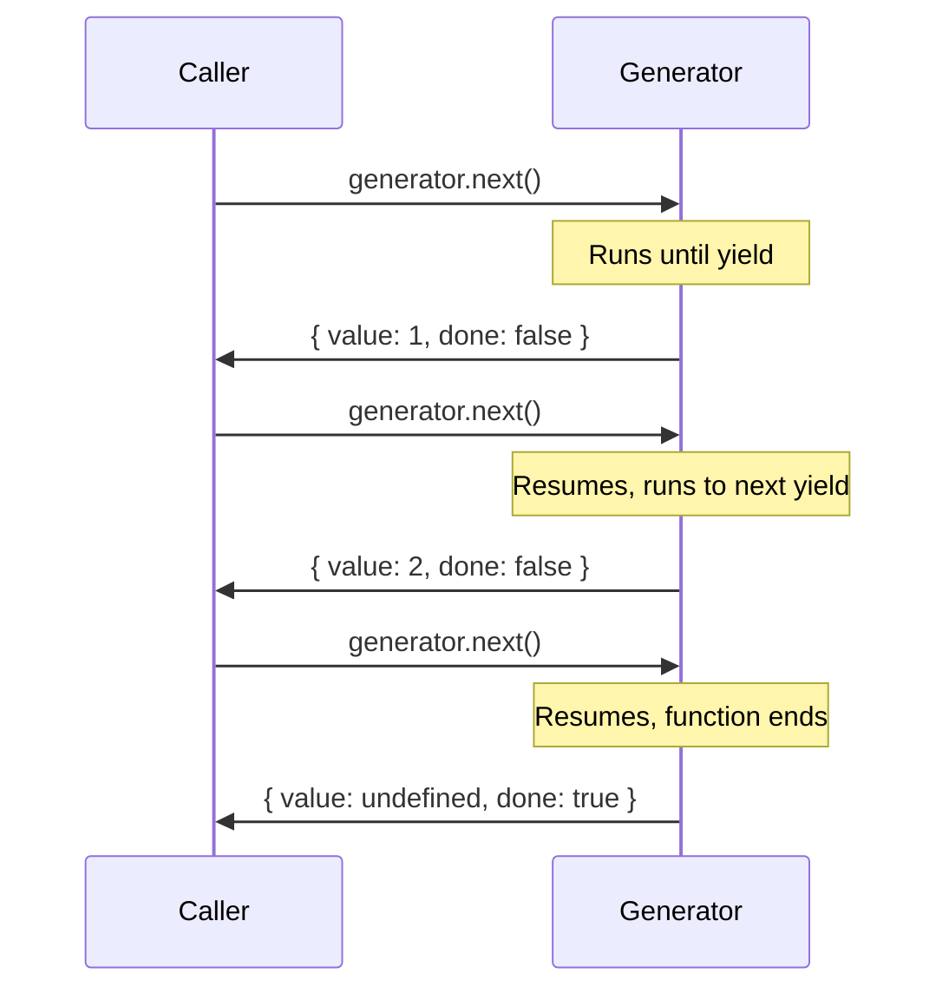

# Generators

## Introduction

**Generators** are special functions that can be **paused and resumed**. They use the `function*` syntax and the `yield` keyword to produce sequences lazily.

## Learning Objectives

- Write generator functions with `function*` and `yield`
- Understand lazy evaluation
- Use `yield*` for delegation
- Create async generators
- Use generators for state machines and infinite sequences

## Visual Summary



## Topics Covered

| Topic | Description | Est. Time |
|-------|-------------|-----------|
| [Generator Functions](./generator-functions) | function*, yield, next() | 15 min |
| [yield](./yield) | yield* delegation, passing values | 15 min |
| [Async Generators](./async-generators) | for await...of, async generator functions | 10 min |

## Prerequisites

- Iterators and the iteration protocol
- Functions and execution context
- Async/await basics

## Learning Path

```
Generator Functions → yield → Async Generators
```

## Related Topics

- [Iterators](../iterators/)
- [Promises](../phase-03-asynchronous-javascript/promises)
- [Symbols](../symbols/)
