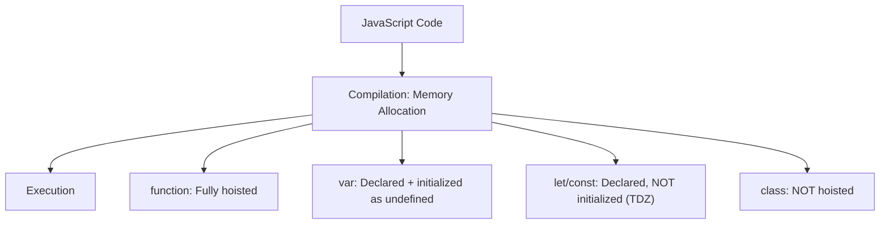

# Hoisting

## Introduction

**Hoisting** is JavaScript's behavior of **moving declarations** (but not assignments) to the top of their scope during the compilation phase.

## Learning Objectives

- Understand how `var`, `let`, `const`, and `function` are hoisted differently
- Explain the Temporal Dead Zone (TDZ)
- Write code that avoids hoisting confusion

## Visual Summary



## Topics Covered

| Topic | Description | Est. Time |
|-------|-------------|-----------|
| [Function Hoisting](./function-hoisting) | How function declarations are hoisted | 10 min |
| [var Hoisting](./var-hoisting) | How var declarations are hoisted | 10 min |
| [let/const Hoisting](./let-const-hoisting) | TDZ and block scoping | 15 min |
| [Temporal Dead Zone](./temporal-dead-zone) | The TDZ explained in detail | 10 min |

## Prerequisites

- Execution context basics
- Variable declarations with var, let, const
- Function declarations vs expressions

## Learning Path

```
Function Hoisting → var Hoisting → let/const Hoisting → Temporal Dead Zone
```

## Related Topics

- [Execution Context](../execution-context/)
- [Scope](../../phase-01-fundamentals/08-scope/)
- [Variables](../../phase-01-fundamentals/03-variables/)
