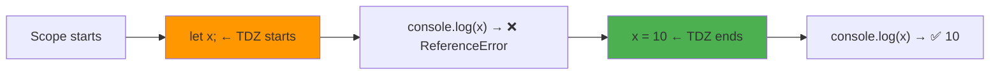

# Temporal Dead Zone (TDZ)

## Introduction

The **Temporal Dead Zone (TDZ)** is the time between entering a scope (where a `let`/`const` variable is hoisted) and reaching the variable's declaration. During the TDZ, accessing the variable throws a `ReferenceError`.

## Visual Explanation



## Why the TDZ Exists

The TDZ exists to catch programming errors early. Accessing a variable before its declaration is almost always a bug:

```javascript
// Without TDZ (like var):
var x = 10;
function test() {
  console.log(x); // undefined — confusing!
  var x = 20;
}

// With TDZ (let/const):
let x = 10;
function test() {
  console.log(x); // ReferenceError — clear error!
  let x = 20;
}
```

## Common TDZ Scenarios

```javascript
// 1. Access before declaration
{
  console.log(val); // ReferenceError
  let val = 10;
}

// 2. TDZ with typeof
{
  console.log(typeof val); // ReferenceError!
  let val = 10;
}
// Note: typeof with undeclared variables returns 'undefined'
// But with TDZ variables, it throws!

// 3. TDZ with default parameters
function test(x = y, y = 10) {
  console.log(x, y);
}
test(); // ReferenceError: Cannot access 'y' before initialization
```

## TDZ and Classes

```javascript
// Classes are in the TDZ
const obj = new MyClass(); // ReferenceError
class MyClass {}
```

## Best Practices

- Declare `let` and `const` at the **top** of their scope
- Never access a variable before its declaration
- Use `const` by default, `let` when reassignment is needed
- Avoid `typeof` checks on TDZ variables

## Summary

- TDZ: time between scope entry and variable declaration
- Accessing TDZ variables throws `ReferenceError`
- `var` has no TDZ (returns `undefined`)
- `let`, `const`, and `class` are in the TDZ
- TDZ helps catch bugs early

## Further Reading

- [MDN: Temporal Dead Zone](https://developer.mozilla.org/en-US/docs/Web/JavaScript/Reference/Statements/let#temporal_dead_zone_tdz)
- [Previous: let/const Hoisting](./let-const-hoisting)
