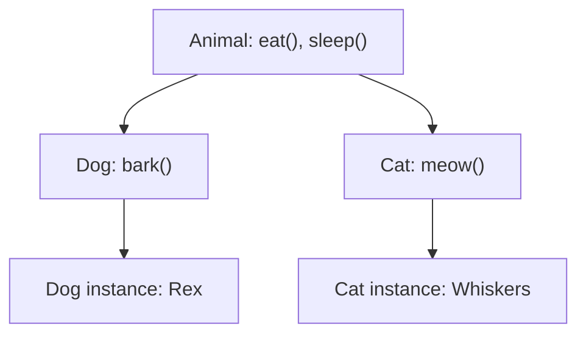

# Inheritance

## Introduction

Inheritance in JavaScript is **prototypal** — objects inherit from other objects. This is fundamentally different from classical inheritance in languages like Java or C++.

## Learning Objectives

- Understand prototypal vs classical inheritance
- Use constructor functions for inheritance
- Use ES6 class syntax with `extends`
- Understand composition as an alternative
- Know when to use inheritance vs composition

## Visual Summary



## Topics Covered

| Topic | Description | Est. Time |
|-------|-------------|-----------|
| [Prototypal Inheritance](./prototypal-inheritance) | Classical-style using constructor functions | 20 min |
| [Class Inheritance](./class-inheritance) | extends, super, method overriding | 15 min |
| [Composition vs Inheritance](./composition-vs-inheritance) | Favor composition over inheritance | 15 min |

## Prerequisites

- Prototypes and the prototype chain
- Constructor functions
- ES6 class syntax

## Learning Path

```
Prototypal Inheritance → Class Inheritance → Composition vs Inheritance
```

## Related Topics

- [Prototypes](../prototypes/)
- [Classes](../classes/)
- [Execution Context](../execution-context/)
