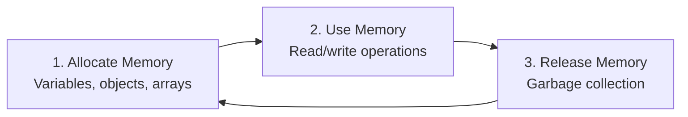

# Memory Lifecycle

## Introduction

Every piece of memory in JavaScript goes through three stages: **allocate**, **use**, and **release**.

## The Three Stages



## Stage 1: Allocation

JavaScript automatically allocates memory when you create values:

```javascript
// Allocating primitives on the stack
const name = 'Alice';    // string
const age = 30;          // number
const active = true;     // boolean

// Allocating objects on the heap
const user = {           // object
  name: 'Alice',
  skills: ['JS', 'React'] // array (also on heap)
};

// Allocating functions (on the heap)
function greet() {
  return 'Hello!';
}
```

## Stage 2: Usage

When you read or write variables, you're using allocated memory:

```javascript
const user = { name: 'Alice', age: 30 };

// Reading (using the memory)
console.log(user.name); // 'Alice'

// Writing (modifying the memory)
user.age = 31;
user.skills = ['JS'];
```

## Stage 3: Release

Memory is released when it's no longer **reachable**. The garbage collector handles this automatically:

```javascript
function process() {
  const temp = { data: 'temporary' };
  // temp is allocated and used here
  return 42;
  // After the function returns, temp is unreachable
  // Its memory can be released
}

// Global references persist
const persistent = { data: 'stays in memory' };
```

## Reachability

An object is "reachable" if it can be accessed from the **roots** (global object, current function's local variables, call stack):

```javascript
let user = { name: 'Alice' };      // ✅ reachable (via 'user')
user = null;                         // ❌ unreachable → eligible for GC

// Longer chain
let data = { value: 42 };           // ✅ reachable
let reference = data;               // ✅ reachable (via 'reference' too)
reference = null;                    // ✅ still reachable (via 'data')
data = null;                         // ❌ unreachable → eligible for GC
```

## Best Practices

- Release references when done: `obj = null`
- Avoid unnecessary global variables
- Clear arrays/lists when no longer needed
- Remove event listeners when unmounting

## Further Reading

- [MDN: Memory Management](https://developer.mozilla.org/en-US/docs/Web/JavaScript/Memory_Management)
- [Previous: Stack vs Heap](./stack-vs-heap)
- [Next: Memory Leaks](./memory-leaks)
