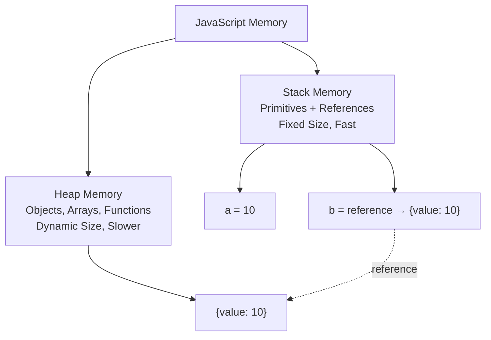

# Stack vs Heap

## Introduction

JavaScript uses two memory areas: the **stack** for primitives and function calls, and the **heap** for objects, arrays, and functions.

## Stack Memory

- Stores **primitive values** (strings, numbers, booleans)
- Stores **references** to heap objects
- Fixed size, fast access
- Automatically managed (function scope)
- LIFO (Last In, First Out)

## Heap Memory

- Stores **objects, arrays, functions**
- Dynamic size, slower access
- Managed by garbage collector
- No fixed limit (depends on system memory)

```javascript
// Stack: primitive values
let a = 10;
let b = a;     // b is an independent copy
b = 20;
console.log(a); // 10 — unchanged

// Heap: objects
const obj1 = { value: 10 };
const obj2 = obj1;  // obj2 holds the same reference
obj2.value = 20;
console.log(obj1.value); // 20 — same object!
```

## Visual Explanation



## Pass by Value vs Pass by Reference

```javascript
// Primitives: passed by value (copy)
function changePrimitive(x) {
  x = 100; // only changes the local copy
}
let num = 50;
changePrimitive(num);
console.log(num); // 50 — unchanged

// Objects: passed by reference (same object)
function changeObject(obj) {
  obj.value = 100; // modifies the original
}
const data = { value: 50 };
changeObject(data);
console.log(data.value); // 100 — changed!
```

## Best Practices

- Keep function parameters and local variables minimal
- Avoid deep object nesting in hot paths
- Use primitives where possible for performance

## Further Reading

- [MDN: Memory Management](https://developer.mozilla.org/en-US/docs/Web/JavaScript/Memory_Management)
- [Next: Memory Lifecycle](./memory-lifecycle)
