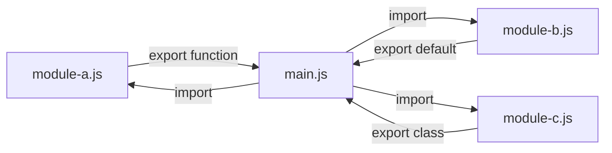

# Modules

## Introduction

ES Modules (ESM) are JavaScript's official module system. Each module is a **separate file** with its own scope. Variables and functions are not accessible outside unless explicitly exported.

## Learning Objectives

- Use named and default exports/imports
- Understand dynamic imports for lazy loading
- Know the difference between ESM and CommonJS
- Use barrel files for organized exports
- Understand module scope and strict mode

## Visual Summary



## Topics Covered

| Topic | Description | Est. Time |
|-------|-------------|-----------|
| [Named Exports](./named-exports) | Exporting multiple values, renaming | 15 min |
| [Default Exports](./default-exports) | Single main export per module | 10 min |
| [Dynamic Import](./dynamic-import) | Lazy loading modules with import() | 15 min |
| [ESM vs CommonJS](./esm-vs-commonjs) | Differences between module systems | 10 min |

## Prerequisites

- Functions and scope
- Understanding of file organization
- Basic Node.js or browser environment

## Learning Path

```
Named Exports → Default Exports → Dynamic Import → ESM vs CommonJS
```

## Key Concepts

- Each module has its own scope
- Modules are always in **strict mode**
- Modules are **deferred by default** in the browser
- `import` and `export` are static (analyzed at compile time)
- Dynamic imports use `import()` (returns a Promise)

## Related Topics

- [Execution Context](../execution-context/)
- [Promises](../phase-03-asynchronous-javascript/promises)
