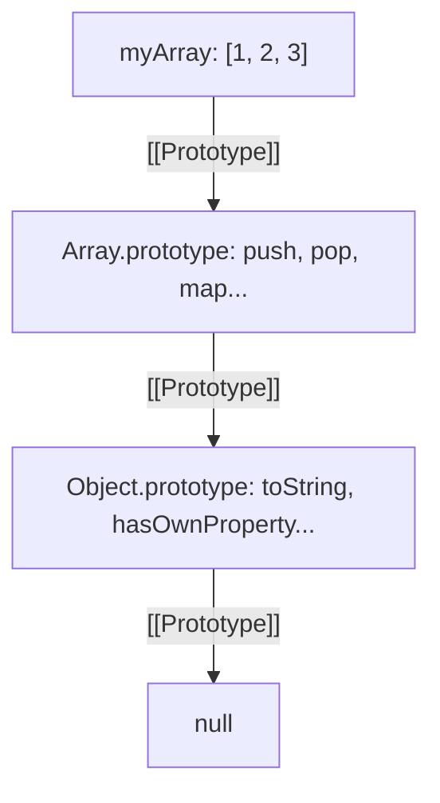

# Prototypes

## Introduction

Every JavaScript object has a **prototype** — an internal reference to another object from which it inherits properties. This is JavaScript's mechanism for **prototypal inheritance**.

## Learning Objectives

- Understand the prototype chain and how property lookup works
- Learn how to set and get prototypes
- Master `Object.create()` for prototypal inheritance
- Understand built-in prototypes (Array.prototype, etc.)
- Know when to use prototypes vs instance properties

## Visual Summary



## Topics Covered

| Topic | Description | Est. Time |
|-------|-------------|-----------|
| [Prototype Chain](./prototype-chain) | How property lookup traverses the chain | 15 min |
| [Setting Prototypes](./setting-prototypes) | Object.create, __proto__, setPrototypeOf | 15 min |
| [Built-in Prototypes](./built-in-prototypes) | Array, Function, Object prototypes | 10 min |
| [Prototype vs Instance](./prototype-vs-instance) | Own properties vs inherited, hasOwnProperty | 10 min |

## Prerequisites

- Objects and how they work
- Functions and constructors
- Basic understanding of inheritance

## Learning Path

```
Prototype Chain → Setting Prototypes → Built-in Prototypes → Prototype vs Instance
```

## Key Concepts

- Every object has a `[[Prototype]]` (internal link to another object)
- Property lookup walks up the chain until found or `null`
- `Object.create()` creates objects with a specific prototype
- Methods on the prototype are **shared** across all instances
- The chain always ends at `null`

## Related Topics

- [Inheritance](../inheritance/)
- [Classes](../classes/)
- [Execution Context](../execution-context/)
