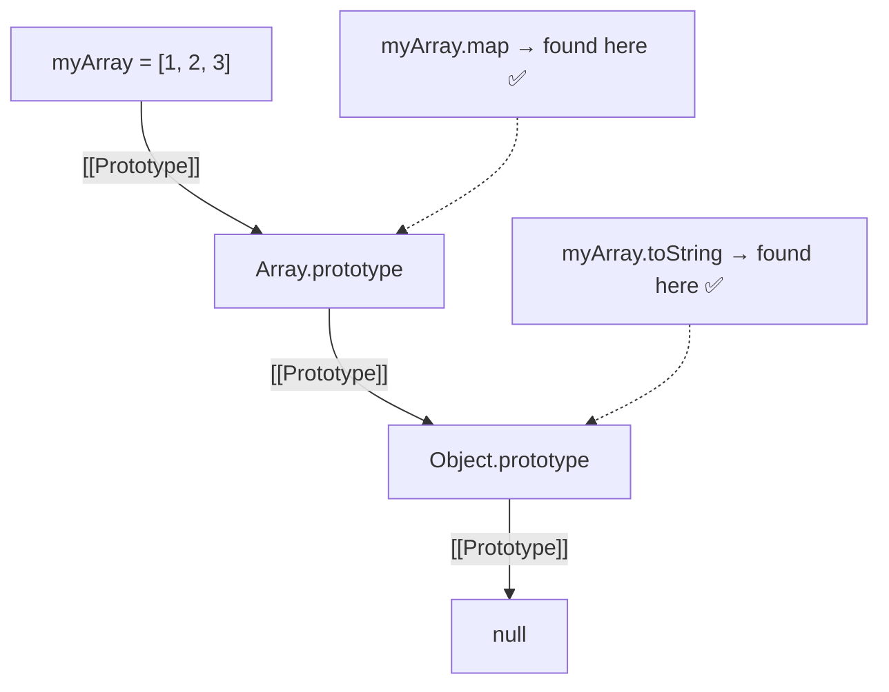

# The Prototype Chain

## Introduction

The **prototype chain** is the mechanism JavaScript uses for inheritance. When you access a property on an object, JavaScript first checks the object's **own properties**. If not found, it follows the `[[Prototype]]` link to the next object, continuing until the property is found or the chain ends at `null`.

## Visual Explanation



## Property Lookup Process

```javascript
const parent = { inherited: 'I am inherited' };
const child = Object.create(parent);
child.own = 'I am own';

console.log(child.own);        // 'I am own' — own property
console.log(child.inherited);  // 'I am inherited' — from prototype!
console.log(child.toString()); // '[object Object]' — from Object.prototype!
console.log(child.nonexistent); // undefined — not found anywhere
```

## Step by Step

```javascript
// 1. Check child.own → found! Return 'I am own'
// 2. Check child.inherited → not own → check child.[[Prototype]]
//    → found on parent! Return 'I am inherited'
// 3. Check child.toString → not own → check child.[[Prototype]]
//    → not on parent → check parent.[[Prototype]]
//    → found on Object.prototype! Return function
// 4. Check child.nonexistent → not found anywhere → return undefined
```

## The Chain Ends at null

```javascript
console.log(Object.getPrototypeOf(Object.prototype)); // null
// This is where the chain stops — no more lookups
```

## Example with Arrays

```javascript
const arr = [1, 2, 3];

// arr → Array.prototype → Object.prototype → null
console.log(arr.__proto__ === Array.prototype);        // true
console.log(arr.__proto__.__proto__ === Object.prototype); // true
console.log(arr.__proto__.__proto__.__proto__);        // null

arr.map(x => x * 2);  // found on Array.prototype
arr.hasOwnProperty(0); // found on Object.prototype (via Array.prototype)
```

## Performance Implications

- ✅ Own properties are fastest to access
- ⚠️ Each prototype hop adds slight overhead
- ⚠️ Long prototype chains can impact performance
- Modern engines optimize common chain lookups

## Best Practices

- Keep prototype chains shallow (3-4 levels max)
- Avoid modifying built-in prototypes
- Use `hasOwnProperty()` to distinguish own vs inherited

## Summary

- Property lookup walks the prototype chain
- Own properties take priority over inherited ones
- The chain ends at `Object.prototype` → `null`
- Longer chains = slower lookups
- `Object.getPrototypeOf()` shows the next link

## Further Reading

- [MDN: Inheritance and the Prototype Chain](https://developer.mozilla.org/en-US/docs/Web/JavaScript/Inheritance_and_the_prototype_chain)
- [Next: Setting Prototypes](./setting-prototypes)
