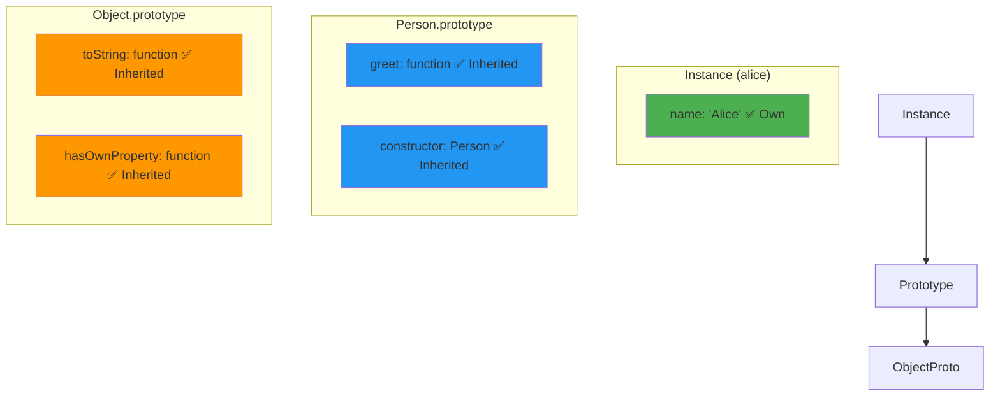

# Prototype vs Instance

## Introduction

Properties can exist **directly on an instance** (own properties) or be **inherited from the prototype**. Understanding the difference is crucial for debugging, performance, and inheritance.

## Own vs Inherited

```javascript
function Person(name) {
  this.name = name; // own property — on the instance
}

Person.prototype.greet = function() { // inherited — on the prototype
  return `Hi, I'm ${this.name}`;
};

const alice = new Person('Alice');

console.log(alice.hasOwnProperty('name'));  // true — own
console.log(alice.hasOwnProperty('greet')); // false — inherited
console.log('greet' in alice);               // true — found in chain
```

## Visual Explanation



## Checking Properties

```javascript
const obj = { own: 'value' };

// 1. hasOwnProperty() — checks OWN properties only
console.log(obj.hasOwnProperty('own'));              // true
console.log(obj.hasOwnProperty('toString'));         // false

// 2. in operator — checks OWN + inherited
console.log('own' in obj);                            // true
console.log('toString' in obj);                       // true

// 3. Object.keys() — own enumerable only
console.log(Object.keys(obj));                        // ['own']

// 4. for...in — own + inherited enumerable
for (let key in obj) console.log(key);                // 'own', 'toString' (if enumerable)
```

## Memory Efficiency

Methods on the prototype are **shared** across all instances:

```javascript
function Person(name) {
  this.name = name;
}

// ✅ Efficient: all instances share one greet function
Person.prototype.greet = function() {
  return `Hello, I'm ${this.name}`;
};

const alice = new Person('Alice');
const bob = new Person('Bob');

console.log(alice.greet === bob.greet); // true — same function!

// ❌ Inefficient: each instance gets its own copy
function BadPerson(name) {
  this.name = name;
  this.greet = function() { // this is created for EVERY instance
    return `Hello, I'm ${this.name}`;
  };
}

const charlie = new BadPerson('Charlie');
const dave = new BadPerson('Dave');
console.log(charlie.greet === dave.greet); // false — different functions!
```

## Adding Properties to Instances

You can **shadow** prototype properties by adding an own property with the same name:

```javascript
function Person(name) { this.name = name; }
Person.prototype.greet = function() { 
  return `Hello, I'm ${this.name}`; 
};

const alice = new Person('Alice');

// Shadow the prototype method
alice.greet = function() {
  return `Hi there, I'm ${this.name}!`;
};

console.log(alice.greet()); // "Hi there, I'm Alice!" — own property wins
// Other instances still use the prototype version
const bob = new Person('Bob');
console.log(bob.greet()); // "Hello, I'm Bob" — prototype method
```

## Performance

```javascript
// ✅ Own properties are fastest
// ❌ Prototype chain lookup adds overhead

// For hot paths, consider copying prototype methods to instance
// (Usually not necessary — engines optimize this well)
```

## Best Practices

- Put **shared methods** on the prototype
- Put **instance-specific data** in the constructor
- Use `hasOwnProperty()` to distinguish own vs inherited
- Be aware of shadowing (own property hiding prototype method)

## Summary

- **Own properties**: directly on the object
- **Inherited properties**: found through the prototype chain
- `hasOwnProperty()` checks own only; `in` checks both
- Methods on prototype are shared (memory efficient)
- Own properties shadow prototype properties

## Further Reading

- [MDN: hasOwnProperty](https://developer.mozilla.org/en-US/docs/Web/JavaScript/Reference/Global_Objects/Object/hasOwnProperty)
- [Previous: Built-in Prototypes](./built-in-prototypes)
