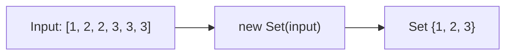

# Set

## Introduction

A **Set** is a collection of **unique values** — each value can only occur once. Sets can store any type (primitives and object references).

## Learning Objectives

- Create and manipulate Set collections
- Use Set for array deduplication
- Perform union, intersection, and difference operations
- Understand WeakSet for memory-safe tracking

## Visual Summary



## Topics Covered

| Topic | Description | Est. Time |
|-------|-------------|-----------|
| [Set Methods](./set-methods) | add, has, delete, clear, size | 10 min |
| [Set Operations](./set-operations) | Union, intersection, difference | 15 min |
| [WeakSet](./weakset) | Garbage-collectable Set | 10 min |

## Prerequisites

- Arrays and their methods
- Basic understanding of collections

## Learning Path

```
Set Methods → Set Operations → WeakSet
```

## Related Topics

- [Map](../map/)
- [WeakMap & WeakSet](../weakmap-weakset/)
- [Arrays](../../phase-01-fundamentals/09-arrays/)
