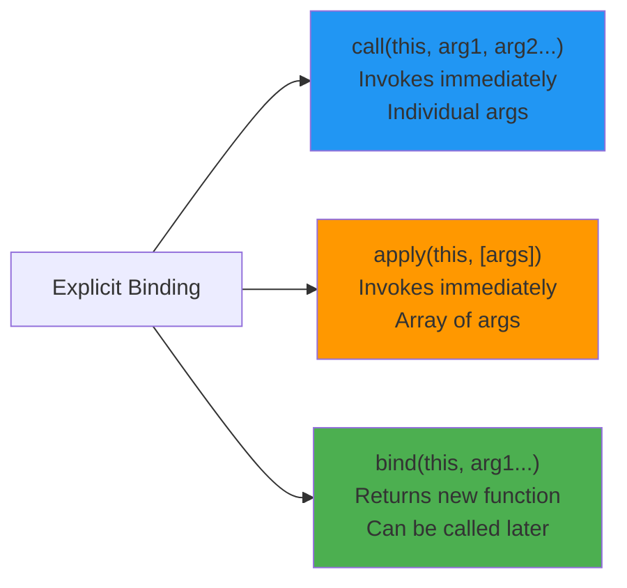

# Explicit Binding

## Introduction

**Explicit binding** lets you **manually set** the value of `this` using three methods: `call()`, `apply()`, and `bind()`. This gives you direct control over what `this` refers to.

## call()

`call()` invokes the function immediately with a specified `this` value and **individual arguments**:

```javascript
function greet(greeting, punctuation) {
  console.log(`${greeting}, I'm ${this.name}${punctuation}`);
}

const user = { name: 'Alice' };

greet.call(user, 'Hello', '!'); 
// "Hello, I'm Alice!"
```

## apply()

`apply()` is like `call()`, but takes arguments as an **array**:

```javascript
function greet(greeting, punctuation) {
  console.log(`${greeting}, I'm ${this.name}${punctuation}`);
}

const user = { name: 'Bob' };

greet.apply(user, ['Hi', '?']); 
// "Hi, I'm Bob?"
```

## bind()

`bind()` returns a **new function** with `this` permanently bound:

```javascript
function greet() {
  console.log(`Hello, I'm ${this.name}`);
}

const user = { name: 'Charlie' };
const boundGreet = greet.bind(user);

boundGreet(); // "Hello, I'm Charlie" — this is always user
```

## call vs apply vs bind



## Practical Examples

### Borrowing Methods

```javascript
const person = {
  name: 'Alice',
  greet() {
    console.log(`Hi, I'm ${this.name}`);
  }
};

const anotherPerson = { name: 'Bob' };

// Borrow greet method
person.greet.call(anotherPerson); // "Hi, I'm Bob"
```

### Using Math Methods with Arrays

```javascript
const numbers = [1, 5, 3, 9, 2];

// Math.max/min don't accept arrays directly
const max = Math.max.apply(null, numbers); // 9
const min = Math.min.apply(null, numbers); // 1

// Modern alternative: spread operator
const max2 = Math.max(...numbers);
```

### Partial Application with bind

```javascript
function multiply(a, b) {
  return a * b;
}

const double = multiply.bind(null, 2);
console.log(double(5)); // 10

const triple = multiply.bind(null, 3);
console.log(triple(5)); // 15
```

## Priority

Explicit binding takes precedence over implicit and default binding, but loses to `new` binding.

```javascript
const obj = { name: 'Object' };
const obj2 = { name: 'Another' };

function show() {
  console.log(this.name);
}

const bound = show.bind(obj);
bound.call(obj2); // "Object" — bind wins over call!
```

## Best Practices

- Use `call()` when you need to invoke immediately with individual args
- Use `apply()` when args are in an array
- Use `bind()` to create permanent `this` bindings for callbacks
- `bind()` is essential for event handlers and setTimeout callbacks

## Summary

| Method | Invokes Immediately | Returns | Arguments | Use Case |
|--------|-------------------|---------|-----------|----------|
| `call()` | ✅ Yes | Result | Individual | Method borrowing |
| `apply()` | ✅ Yes | Result | Array | Spreading arrays |
| `bind()` | ❌ No | New function | Individual | Callbacks, partial application |

## Further Reading

- [MDN: Function.prototype.call](https://developer.mozilla.org/en-US/docs/Web/JavaScript/Reference/Global_Objects/Function/call)
- [MDN: Function.prototype.apply](https://developer.mozilla.org/en-US/docs/Web/JavaScript/Reference/Global_Objects/Function/apply)
- [MDN: Function.prototype.bind](https://developer.mozilla.org/en-US/docs/Web/JavaScript/Reference/Global_Objects/Function/bind)
