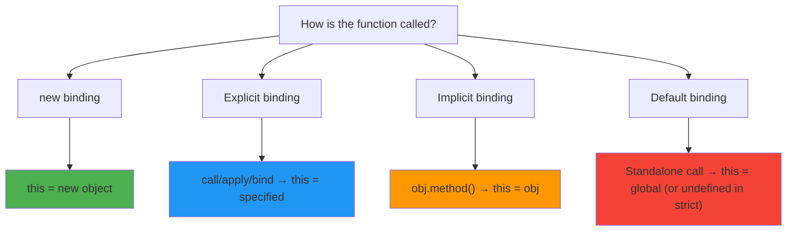

# The this Keyword

## Introduction

`this` is a special keyword that refers to the **object that is executing the current function**. Its value is determined by **how the function is called** (not where it's defined).

## Learning Objectives

- Understand the four binding rules for `this`
- Distinguish between default, implicit, explicit, and `new` binding
- Understand how arrow functions handle `this` (lexical scoping)
- Master `call`, `apply`, and `bind`
- Avoid common pitfalls with `this`

## Visual Summary



## Topics Covered

| Topic | Description | Est. Time |
|-------|-------------|-----------|
| [Default Binding](./default-binding) | Standalone function calls, strict mode | 10 min |
| [Implicit Binding](./implicit-binding) | Method calls, object context | 10 min |
| [Explicit Binding](./explicit-binding) | call, apply, bind | 15 min |
| [new Binding](./new-binding) | Constructor calls with `new` | 10 min |
| [Arrow Functions](./arrow-functions) | Lexical `this`, no own `this` | 15 min |
| [Common Pitfalls](./common-pitfalls) | Losing `this`, event handlers, callbacks | 15 min |

## Prerequisites

- Functions and execution context
- Objects and methods
- Arrow functions

## Learning Path

```
Default Binding → Implicit Binding → Explicit Binding → new Binding → Arrow Functions → Common Pitfalls
```

## Quick Reference — Priority Order

1. **new binding** 🥇 — `new foo()` → `this` = new object
2. **Explicit binding** 🥈 — `foo.call(obj)`, `foo.apply(obj)`, `foo.bind(obj)`
3. **Implicit binding** 🥉 — `obj.foo()` → `this` = `obj`
4. **Default binding** 4️⃣ — `foo()` → `this` = global/undefined

## Related Topics

- [Execution Context](../execution-context/)
- [Arrow Functions](../functions/arrow-functions)
- [Call Stack](../call-stack/)
