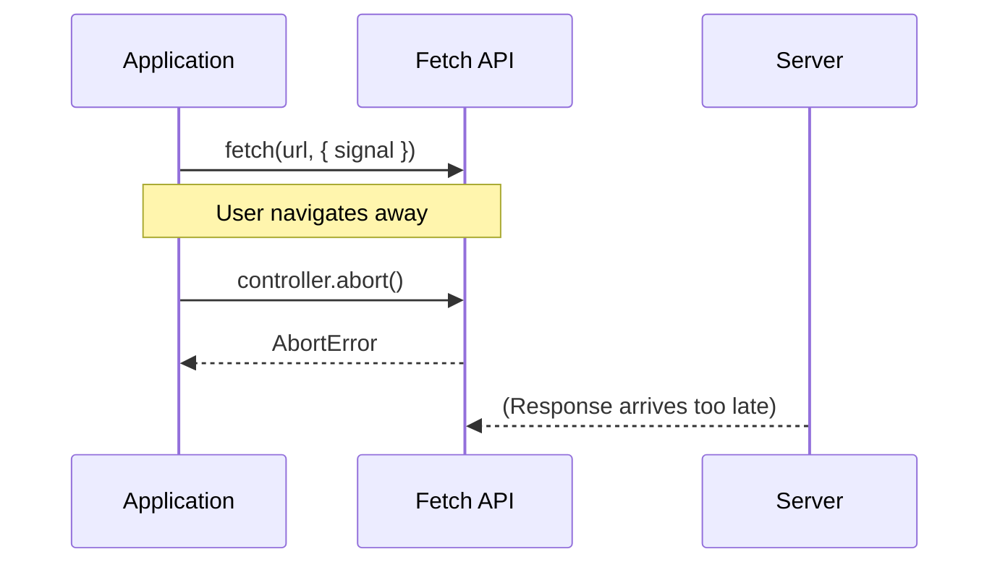

# Basic Usage

## Introduction

AbortController starts a request and cancels it when needed using an AbortSignal.

## Simple Example

```javascript
const controller = new AbortController();
const signal = controller.signal;

fetch('/api/large-data', { signal })
  .then(response => response.json())
  .then(data => console.log(data))
  .catch(err => {
    if (err.name === 'AbortError') {
      console.log('Request was cancelled');
    } else {
      console.error('Request failed:', err);
    }
  });

// Cancel the request
controller.abort();
```

## Visual Explanation



## With Async/Await

```javascript
async function fetchWithCancel(url, signal) {
  try {
    const response = await fetch(url, { signal });
    return await response.json();
  } catch (error) {
    if (error.name === 'AbortError') {
      console.log('Request was cancelled');
      return null;
    }
    throw error;
  }
}
```

## Summary

- Create with `new AbortController()`
- Pass `signal` to fetch options
- Call `controller.abort()` to cancel
- Catch `AbortError` to handle cancellation

## Further Reading

- [MDN: AbortController](https://developer.mozilla.org/en-US/docs/Web/API/AbortController)
