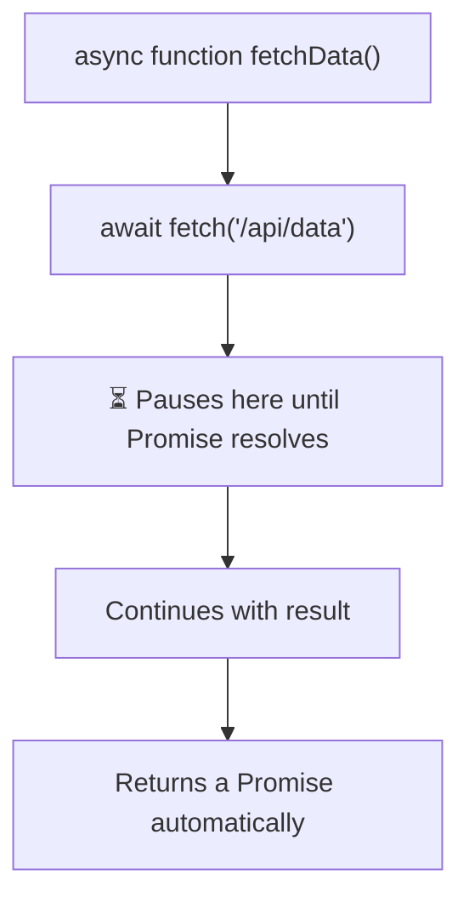

# Async Functions

## Introduction

An `async` function is a function that always returns a Promise. It allows you to use the `await` keyword inside it.

## Basic Syntax

```javascript
// An async function always returns a Promise
async function getData() {
  return 'Hello';
}

console.log(getData()); // Promise { 'Hello' }
getData().then(console.log); // 'Hello'
```

## Arrow Functions

```javascript
const getData = async () => {
  return 'Hello';
};

// With params
const fetchUser = async (id) => {
  const response = await fetch(`/api/users/${id}`);
  return response.json();
};
```

## Visual Explanation



## Summary

- `async` keyword makes a function return a Promise
- Works with function declarations, expressions, and arrow functions
- Inside an async function, you can use `await`
- The returned value is automatically wrapped in a resolved Promise

## Further Reading

- [MDN: async function](https://developer.mozilla.org/en-US/docs/Web/JavaScript/Reference/Statements/async_function)
