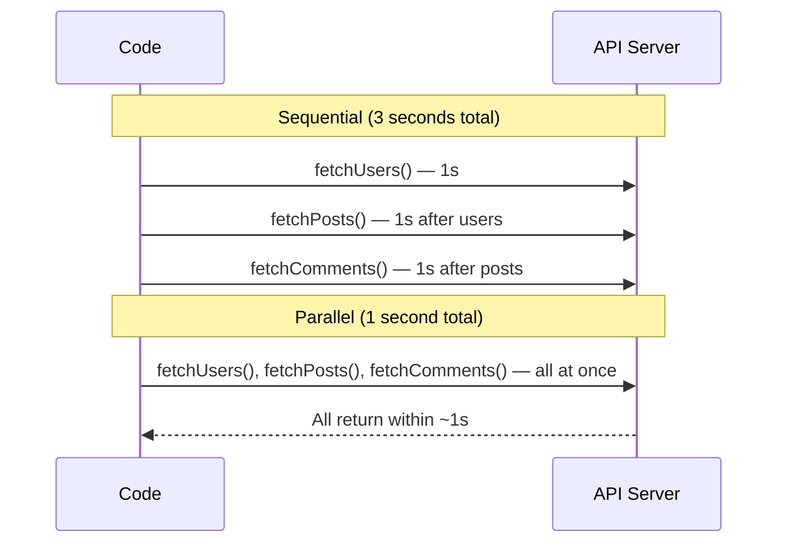

# Parallel Execution

## Introduction

By default, `await` pauses execution, making operations sequential. To run independent operations in parallel, use `Promise.all()`.

## Sequential vs Parallel

```javascript
// ❌ Sequential (slow) — each waits for the previous
async function slow() {
  const users = await fetchUsers();
  const posts = await fetchPosts();     // waits for users
  const comments = await fetchComments(); // waits for posts
}

// ✅ Parallel (fast)
async function fast() {
  const [users, posts, comments] = await Promise.all([
    fetchUsers(),
    fetchPosts(),
    fetchComments()
  ]);
}
```

## Visual Explanation



## When to Use Parallel

```javascript
async function loadDashboard() {
  const start = performance.now();

  // Independent data — parallel
  const [user, notifications, preferences] = await Promise.all([
    fetchUser(),
    fetchNotifications(),
    fetchPreferences()
  ]);

  // Dependent data — sequential
  const posts = await fetchPosts(user.id);
  const comments = await Promise.all(
    posts.map(post => fetchComments(post.id)) // Parallel within sequential
  );

  console.log(`Loaded in ${performance.now() - start}ms`);
  return { user, notifications, preferences, posts, comments };
}
```

## Summary

- Sequential `await` = slow for independent operations
- Use `Promise.all()` with `await` for parallel execution
- Only parallelize truly independent operations
- Combine sequential and parallel for complex data flows

## Further Reading

- [MDN: Promise.all](https://developer.mozilla.org/en-US/docs/Web/JavaScript/Reference/Global_Objects/Promise/all)
