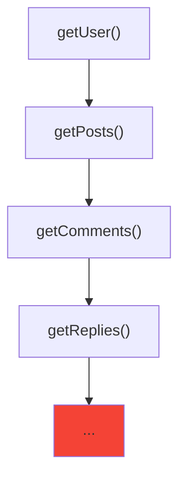

# Callback Hell (Pyramid of Doom)

## Introduction

Callback hell occurs when multiple nested callbacks create a deeply indented, hard-to-read code structure that resembles a pyramid or right-pointing triangle.

## Why Does This Happen?

When you need to perform sequential async operations where each step depends on the previous result, callbacks naturally nest inside each other.

## The Problem

```javascript
// Pyramid of Doom 🔺
getUser(1, (user) => {
  console.log('Got user:', user);

  getPosts(user.id, (posts) => {
    console.log('Got posts:', posts);

    getComments(posts[0].id, (comments) => {
      console.log('Got comments:', comments);

      getReplies(comments[0].id, (replies) => {
        console.log('Got replies:', replies);
        // 🔺 The pyramid grows deeper...
      });
    });
  });
});
```

## Visual Explanation



## Problems with Callback Hell

- ❌ Deep nesting makes code unreadable
- ❌ Error handling is scattered and inconsistent
- ❌ Difficult to parallelize operations
- ❌ No clean way to cancel operations
- ❌ Hard to reason about control flow

## Solutions

| Problem | Solution |
|---------|----------|
| Deep nesting | Promises / Async/Await |
| Error handling | Promise `.catch()` / try-catch |
| Parallel execution | `Promise.all()` |
| Cancellation | AbortController |

## Summary

- Callback hell is deeply nested callbacks forming a pyramid shape
- Makes code hard to read, debug, and maintain
- Promises and async/await solve this problem
- Modern JavaScript avoids this pattern entirely

## Further Reading

- [MDN: Using Promises to escape callback hell](https://developer.mozilla.org/en-US/docs/Web/JavaScript/Guide/Using_promises)
