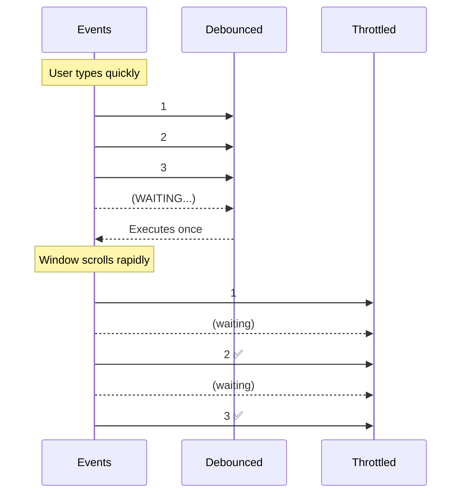

# Debounce vs Throttle

## Introduction

While both patterns rate-limit function calls, they have different behaviors and use cases.

## Quick Comparison

| Feature | Debounce | Throttle |
|---------|----------|----------|
| Fires | After events stop | At regular intervals |
| Use case | Search, validation | Scroll, resize, game loop |
| First execution | After delay (or leading) | Immediately |
| Result | Single execution | Regular executions |

## Visual Comparison

## When to Choose Which

- **Debounce**: When you only care about the final state after rapid events stop (search, validation)
- **Throttle**: When you need regular updates during rapid events (scroll progress, mouse position)

## Summary

| Pattern | Behavior | Best For |
|---------|----------|----------|
| Debounce | Executes after pause | Search, autocomplete, resize |
| Throttle | Executes at intervals | Scroll, mouse tracking, game input |
| Leading debounce | Executes immediately, then debounces | Save buttons, form submit |

## Further Reading

- [MDN: Debounce](https://developer.mozilla.org/en-US/docs/Glossary/Debounce)
- [MDN: Throttle](https://developer.mozilla.org/en-US/docs/Glossary/Throttle)
