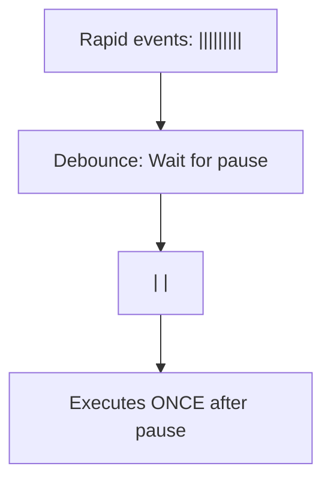

# Debounce

## Introduction

**Debounce** delays function execution until after a specified pause in events. It's like saying "wait until they stop typing, then search."

## How It Works



## Basic Implementation

```javascript
function debounce(fn, delay) {
  let timeoutId;

  return function(...args) {
    clearTimeout(timeoutId);
    timeoutId = setTimeout(() => {
      fn.apply(this, args);
    }, delay);
  };
}

// Usage: Search input
const searchInput = document.getElementById('search');
searchInput.addEventListener('input', debounce(async (e) => {
  const results = await fetch(`/api/search?q=${e.target.value}`);
  displayResults(results);
}, 300));
```

## How It Works Step by Step

1. User types 'h' → timer starts (300ms)
2. User types 'he' → previous timer cleared, new timer starts
3. User types 'hel' → previous timer cleared, new timer starts
4. User stops typing → 300ms passes → function executes once

## Summary

- Delays execution until events stop for a specified time
- Perfect for search inputs, form validation
- Only the final call matters

## Further Reading

- [MDN: Debounce](https://developer.mozilla.org/en-US/docs/Glossary/Debounce)
