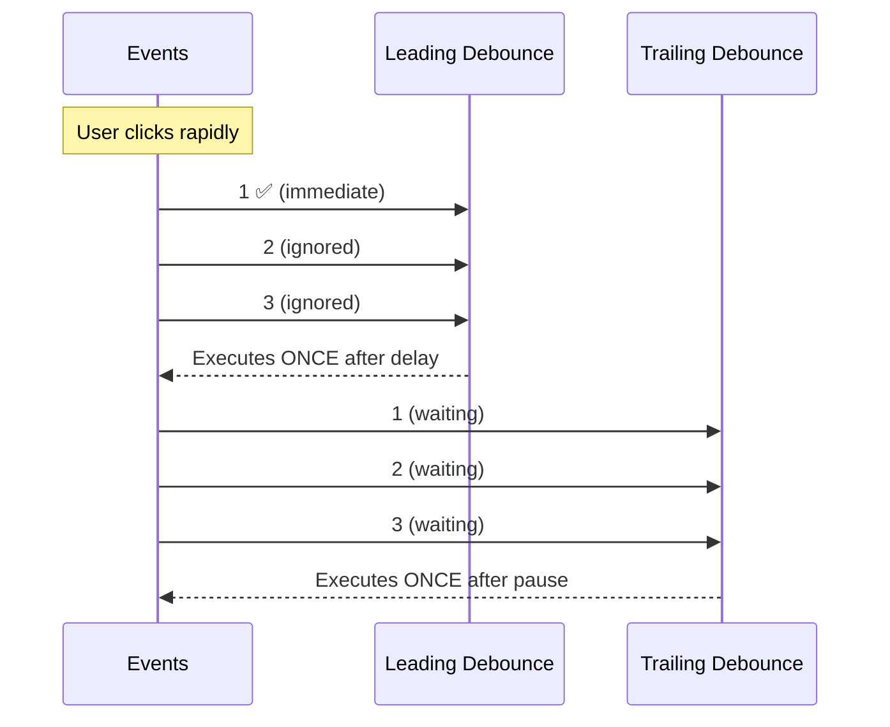

# Leading Option

## Introduction

A leading debounce executes the function **immediately** on the first call, then debounces subsequent calls. Useful when you need instant feedback followed by rate limiting.

## Implementation

```javascript
function debounce(fn, delay, { leading = false } = {}) {
  let timeoutId;
  let lastCall = 0;

  return function(...args) {
    const now = Date.now();
    const isLeading = leading && (now - lastCall >= delay);

    clearTimeout(timeoutId);
    lastCall = now;

    if (isLeading) {
      fn.apply(this, args);
    } else {
      timeoutId = setTimeout(() => {
        fn.apply(this, args);
      }, delay);
    }
  };
}

// Execute immediately, then debounce
const save = debounce(saveToServer, 2000, { leading: true });
```

## Visual Comparison



## When to Use Leading

- **Save buttons**: Execute save immediately, prevent double-save
- **Form submit**: Submit on first click, ignore rapid clicks
- **Game actions**: Fire on first keypress, prevent spam

## Summary

- `leading: true` executes immediately, then debounces
- `leading: false` (default) waits for pause, then executes
- Useful for instant feedback with rate limiting

## Further Reading

- [lodash: debounce](https://lodash.com/docs/4.17.15#debounce)
