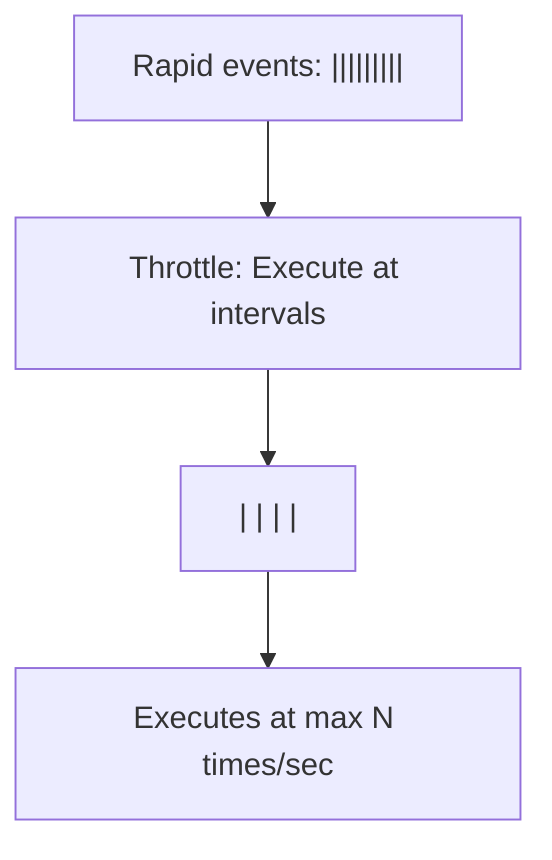

# Throttle

## Introduction

**Throttle** limits a function to execute at most once per specified interval. It's like saying "update the scroll position at most every 100ms."

## How It Works



## Basic Implementation

```javascript
function throttle(fn, limit) {
  let inThrottle = false;

  return function(...args) {
    if (!inThrottle) {
      fn.apply(this, args);
      inThrottle = true;
      setTimeout(() => {
        inThrottle = false;
      }, limit);
    }
  };
}

// Usage: Scroll handler
window.addEventListener('scroll', throttle(() => {
  console.log('Scroll position:', window.scrollY);
  // Update UI based on scroll position
}, 100));
```

## How It Works Step by Step

1. First scroll event → executes immediately, sets `inThrottle = true`
2. More scroll events within 100ms → ignored (throttled)
3. After 100ms → `inThrottle = false`, next event will execute

## Summary

- Limits execution rate to at most once per interval
- First call executes immediately
- Subsequent calls within the interval are ignored
- Perfect for scroll, resize, and mouse move handlers

## Further Reading

- [MDN: Throttle](https://developer.mozilla.org/en-US/docs/Glossary/Throttle)
