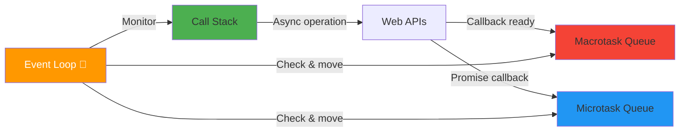
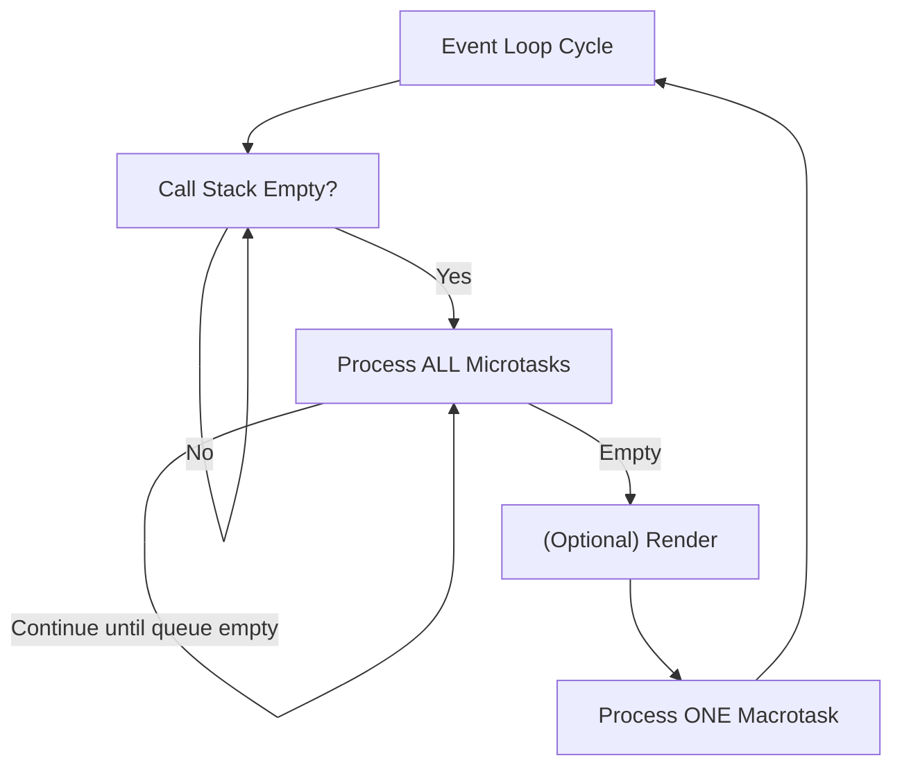

# How It Works

## Introduction

The event loop continuously checks the call stack and task queues, moving callbacks to the stack when it's empty.

## Visual Explanation

## The Four Components

1. **Call Stack** — Executes synchronous code (LIFO)
2. **Web APIs** — Handles async operations (timers, fetch, DOM events)
3. **Microtask Queue** — Promise callbacks, `queueMicrotask()`
4. **Macrotask Queue** — `setTimeout`, `setInterval`, I/O callbacks

## The Event Loop Cycle

## Summary

- Event loop monitors call stack and queues
- Processes all microtasks before each macrotask
- Call stack must be empty before processing callbacks
- Render step happens between microtasks and macrotasks

## Further Reading

- [MDN: Event Loop](https://developer.mozilla.org/en-US/docs/Web/JavaScript/EventLoop)
