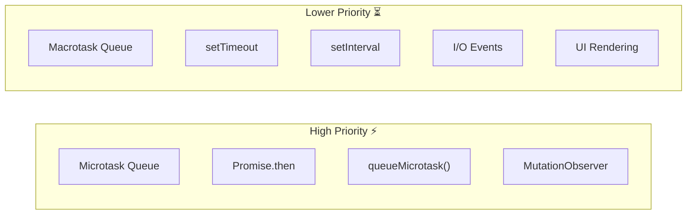

# What Goes Where

## Introduction

Understanding which operations create microtasks vs macrotasks helps you predict execution order.

## Visual Explanation



## Microtasks

| API | Example |
|-----|---------|
| Promise handlers | `.then()`, `.catch()`, `.finally()` |
| `queueMicrotask()` | `queueMicrotask(() => {})` |
| `MutationObserver` | DOM mutation callbacks |
| `process.nextTick()` | Node.js only |

## Macrotasks

| API | Example |
|-----|---------|
| `setTimeout` | `setTimeout(() => {}, 0)` |
| `setInterval` | `setInterval(() => {}, 1000)` |
| I/O operations | Network requests, file system |
| UI rendering | Paint, layout |
| Event handlers | Click, scroll, keypress |

## Why Microtasks Have Higher Priority

Microtasks run right after the current synchronous code, before the next macrotask. This means:

```javascript
setTimeout(() => console.log('timeout'), 0);
Promise.resolve().then(() => console.log('promise'));
// Output: promise, timeout
```

## Summary

- Microtasks: Promise callbacks, queueMicrotask, MutationObserver
- Macrotasks: setTimeout, setInterval, I/O, rendering
- Microtasks always run before macrotasks
- Each event loop cycle processes all microtasks then one macrotask

## Further Reading

- [MDN: Microtask guide](https://developer.mozilla.org/en-US/docs/Web/API/HTML_DOM_API/Microtask_guide)
