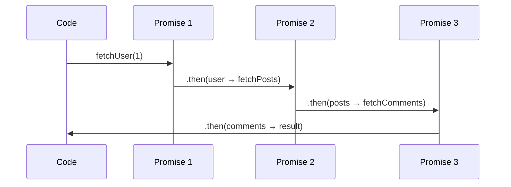

# Basic Chaining

## Introduction

Each `.then()` call returns a new promise, allowing you to chain multiple async operations together in a flat structure.

## Visual Explanation



## Simple Chain

```javascript
const promise = new Promise((resolve) => {
  setTimeout(() => resolve(5), 1000);
});

promise
  .then(value => value * 2)      // 10
  .then(value => value + 3)      // 13
  .then(value => console.log(value)); // 13
```

## Returning Values

```javascript
Promise.resolve(2)
  .then(n => n * 3)   // 6
  .then(n => n + 1)   // 7
  .then(n => n * 2)   // 14
  .then(console.log); // 14
```

## Summary

- Each `.then()` receives the previous return value
- Return a plain value to pass it to the next `.then()`
- Return a promise to wait for it before continuing
- Chains read top-to-bottom, like synchronous code

## Further Reading

- [MDN: Chaining](https://developer.mozilla.org/en-US/docs/Web/JavaScript/Guide/Using_promises#chaining)
