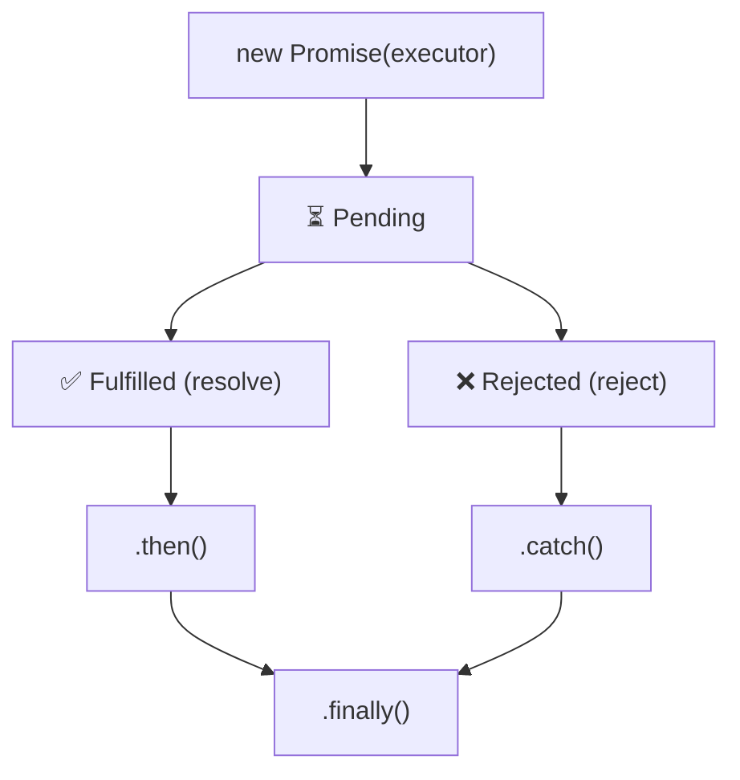

# Promise States

## Introduction

A Promise has three states: **pending**, **fulfilled**, and **rejected**. Once a promise settles (fulfilled or rejected), it cannot change state.

## Visual Explanation



## State Transitions

```javascript
const promise = new Promise((resolve, reject) => {
  // Promise starts as PENDING

  // After resolve() → FULFILLED
  resolve('Success');

  // After reject() → REJECTED
  // reject(new Error('Failed'));

  // Once settled, further resolve/reject calls are ignored
  resolve('This is ignored'); // Already resolved above
});

console.log(promise); // Promise { 'Success' }
```

## Checking State

```javascript
// You can't directly check a promise's state from user code
// But you can observe it through callbacks:

const p = new Promise((resolve) => {
  setTimeout(() => resolve('done'), 1000);
});

console.log(p); // Promise { <pending> } — still pending

p.then(value => {
  console.log(value); // 'done' — now fulfilled
});
```

## Summary

- **Pending**: Initial state, not yet settled
- **Fulfilled**: Operation completed successfully (resolve called)
- **Rejected**: Operation failed (reject called)
- Once settled, state is immutable

## Further Reading

- [MDN: Promise](https://developer.mozilla.org/en-US/docs/Web/JavaScript/Reference/Global_Objects/Promise)
