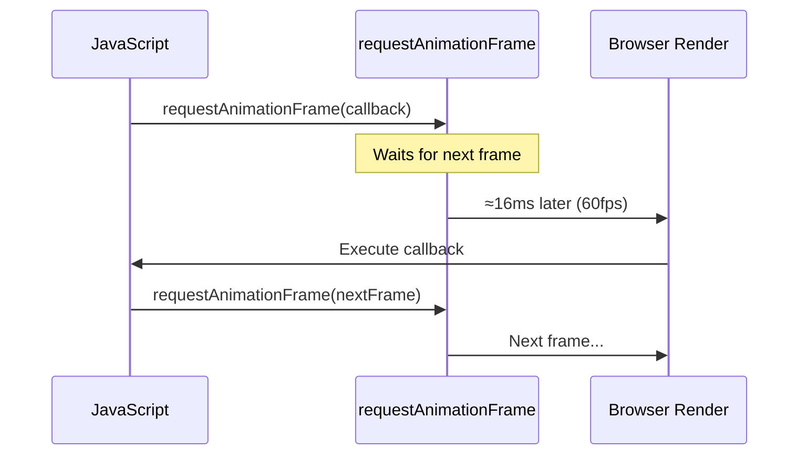

# Basic Animation

## Introduction

Use `requestAnimationFrame` to create smooth, efficient animations that sync with the browser's refresh rate.

## Visual Explanation



## Simple Animation Loop

```javascript
function animate() {
  // Update animation state
  element.style.transform = `translateX(${position}px)`;

  // Continue the animation
  requestAnimationFrame(animate);
}

// Start the animation
requestAnimationFrame(animate);
```

## Animation with Stopping

```javascript
let animationId;
let position = 0;

function animate() {
  position += 2;
  element.style.transform = `translateX(${position}px)`;

  // Stop after 500px
  if (position < 500) {
    animationId = requestAnimationFrame(animate);
  }
}

// Start
animationId = requestAnimationFrame(animate);

// Cancel
cancelAnimationFrame(animationId);
```

## Summary

- Call `requestAnimationFrame(callback)` to start
- Callback receives a timestamp parameter
- Return value is an ID for cancellation
- Use `cancelAnimationFrame(id)` to stop

## Further Reading

- [MDN: requestAnimationFrame](https://developer.mozilla.org/en-US/docs/Web/API/window/requestAnimationFrame)
