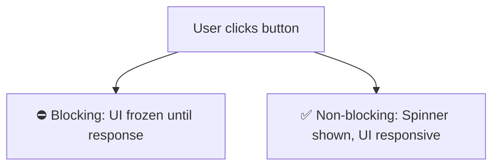

# Blocking vs Non-Blocking

## Introduction

A **blocking** operation prevents further JavaScript execution until it completes. A **non-blocking** operation starts and allows the program to continue while it finishes in the background.

## Why Do We Need This?

Without non-blocking operations, network requests, file reads, and timers would freeze the entire page, making the UI unresponsive.

## Visual Explanation



## Blocking Example

```javascript
// This blocks the entire thread for ~1 second
console.log('Start');
for (let i = 0; i < 1000000000; i++) {
  // busy waiting — nothing else can happen
}
console.log('End');
// Output:
// Start
// (1 second pause — UI frozen)
// End
```

## Non-Blocking Example

```javascript
// This does NOT block — execution continues
console.log('Start');

setTimeout(() => {
  console.log('Inside timeout');
}, 1000);

console.log('End');
// Output:
// Start
// End
// (1 second later)
// Inside timeout
```

## Real-World Impact

| Scenario | Blocking | Non-Blocking |
|----------|----------|--------------|
| Network request | Page frozen for seconds | Spinner shown, UI responsive |
| File reading | App hangs | Background processing |
| Timer | Can't run other code | Other code runs normally |

## Best Practices

- Always use async APIs for I/O operations (network, file, database)
- Offload heavy computations to Web Workers
- Use `setTimeout` to yield to the event loop in long loops

## Summary

- Blocking: stops everything until complete
- Non-blocking: starts operation, continues execution
- All I/O should be non-blocking in production code

## Further Reading

- [MDN: Blocking vs Non-blocking](https://developer.mozilla.org/en-US/docs/Learn/JavaScript/Asynchronous/Introducing)
