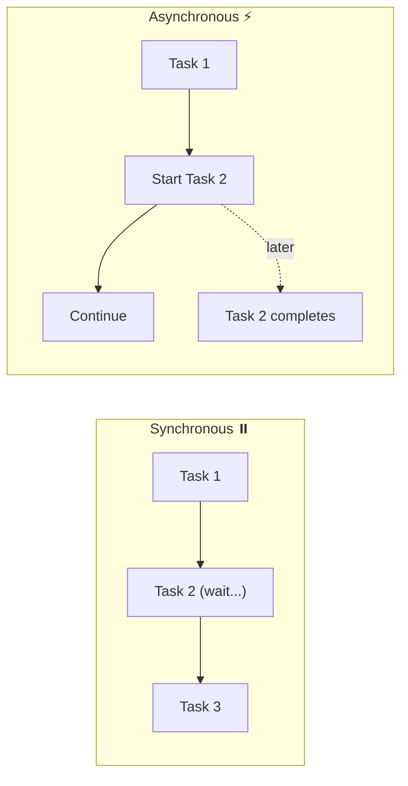

# Execution Model

## Introduction

JavaScript uses a **single-threaded** execution model but handles async operations through the event loop, enabling non-blocking behavior despite being single-threaded.

## Visual Explanation



## Single-Threaded Reality

JavaScript has one call stack — it can do one thing at a time. But the browser provides Web APIs that run in parallel:

1. **Sync code** runs immediately on the call stack
2. **Async operations** (timers, fetch, events) are handed off to Web APIs
3. When async operations complete, their callbacks are queued
4. The event loop moves callbacks back to the call stack when it's empty

## How This Works in Practice

```javascript
// JavaScript engine sees this code:
console.log('A');
setTimeout(() => console.log('B'), 0);
console.log('C');

// 1. console.log('A') → executes immediately
// 2. setTimeout → handed to Web API, timer starts
// 3. console.log('C') → executes immediately
// 4. Call stack empty → event loop checks queues
// 5. setTimeout callback → moved to call stack → executes
// Output: A, C, B
```

## Summary

- JavaScript is single-threaded but non-blocking
- Async operations use the event loop mechanism
- Sync code always completes before async callbacks run
- The call stack must be empty before async callbacks execute

## Further Reading

- [MDN: Event Loop](https://developer.mozilla.org/en-US/docs/Web/JavaScript/EventLoop)
