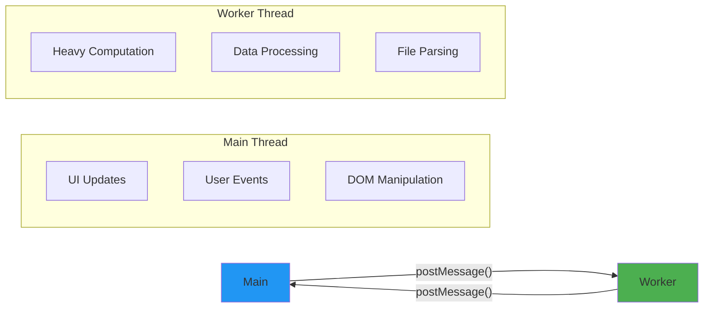

# Main Thread

## Introduction

The main thread creates workers, sends them data, and receives results via `postMessage()` and `onmessage`.

## Creating a Worker

```javascript
// Create a worker from a separate JS file
const worker = new Worker('worker.js');

// Send data to worker
worker.postMessage({ numbers: [1, 2, 3, 4, 5] });

// Receive results from worker
worker.onmessage = (event) => {
  console.log('Result from worker:', event.data);
};

// Handle errors
worker.onerror = (error) => {
  console.error('Worker error:', error.message);
};
```

## Visual Explanation



## Terminating a Worker

```javascript
// Stop the worker
worker.terminate();

// After termination, the worker can no longer be used
```

## Summary

- Create with `new Worker('file.js')`
- Send data with `worker.postMessage(data)`
- Receive with `worker.onmessage = (e) => {}`
- Terminate with `worker.terminate()`

## Further Reading

- [MDN: Using Web Workers](https://developer.mozilla.org/en-US/docs/Web/API/Web_Workers_API/Using_web_workers)
