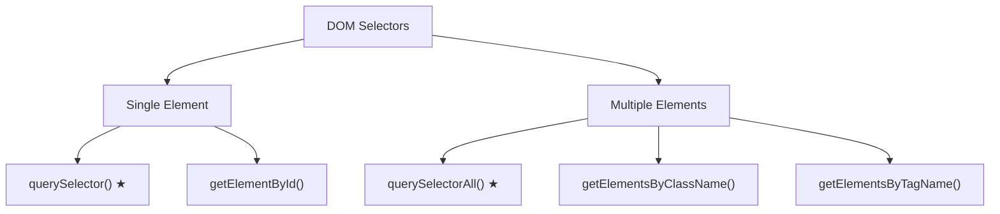

# Modern Selectors

## Introduction

`querySelector()` and `querySelectorAll()` use CSS selector syntax, providing powerful and flexible element selection.

## Single Element

```javascript
// Returns first match or null
document.querySelector('#main');           // By ID
document.querySelector('.article');        // By class
document.querySelector('div');             // By tag
document.querySelector('[data-type="post"]'); // By attribute
document.querySelector('div.container > p'); // CSS selector
```

## Multiple Elements

```javascript
// Returns a static NodeList (not live)
document.querySelectorAll('p');            // All paragraphs
document.querySelectorAll('.item');        // All .item elements
document.querySelectorAll('li:nth-child(2)'); // CSS pseudo-class
document.querySelectorAll('ul > li');      // Direct children
```

## Visual Explanation



## Summary

- `querySelector()` — single element, returns first match
- `querySelectorAll()` — static NodeList of all matches
- Use full CSS selector syntax
- Prefer modern selectors over classic ones

## Further Reading

- [MDN: Document.querySelector](https://developer.mozilla.org/en-US/docs/Web/API/Document/querySelector)
