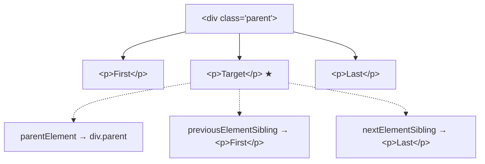

# Traversal Properties

## Introduction

DOM traversal properties let you navigate the DOM tree by moving to parent, child, or sibling elements.

## Visual Explanation



## Traversal Properties

```javascript
const element = document.querySelector('.target');

// Up (parent)
element.parentElement;          // Direct parent element
element.closest('.container');  // Nearest ancestor matching selector

// Sideways (siblings)
element.previousElementSibling; // Previous sibling
element.nextElementSibling;     // Next sibling

// Down (children)
element.children;               // HTMLCollection of children
element.firstElementChild;      // First child
element.lastElementChild;       // Last child
element.querySelector('.child'); // Deep search in children
```

## Summary

- `parentElement` — direct parent
- `previousElementSibling` / `nextElementSibling` — siblings
- `children` — all child elements
- `firstElementChild` / `lastElementChild` — first and last child

## Further Reading

- [MDN: Element](https://developer.mozilla.org/en-US/docs/Web/API/Element)
