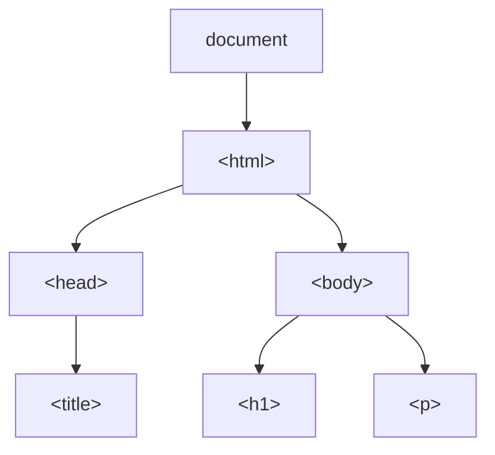

# DOM Tree

## Introduction

The DOM represents an HTML document as a tree of nodes, where each node corresponds to an element, text, attribute, or comment.

## Visual Explanation



## The Document Object

```javascript
// The DOM starts with the document object
console.log(document); // The entire HTML document
console.log(document.head); // <head> element
console.log(document.body); // <body> element
console.log(document.title); // Page title
```

## Node Types

| Node Type | Example |
|-----------|---------|
| Element node | `<div>`, `<p>`, `<h1>` |
| Text node | "Hello World" inside an element |
| Comment node | `<!-- comment -->` |
| Document node | The `document` object itself |

## Summary

- DOM is a tree of nodes representing the HTML document
- `document` is the root entry point
- Node types: element, text, comment, document
- Each element node can have child nodes

## Further Reading

- [MDN: DOM Tree](https://developer.mozilla.org/en-US/docs/Web/API/Document_object_model/Using_the_W3C_DOM_Level_1_Core)
